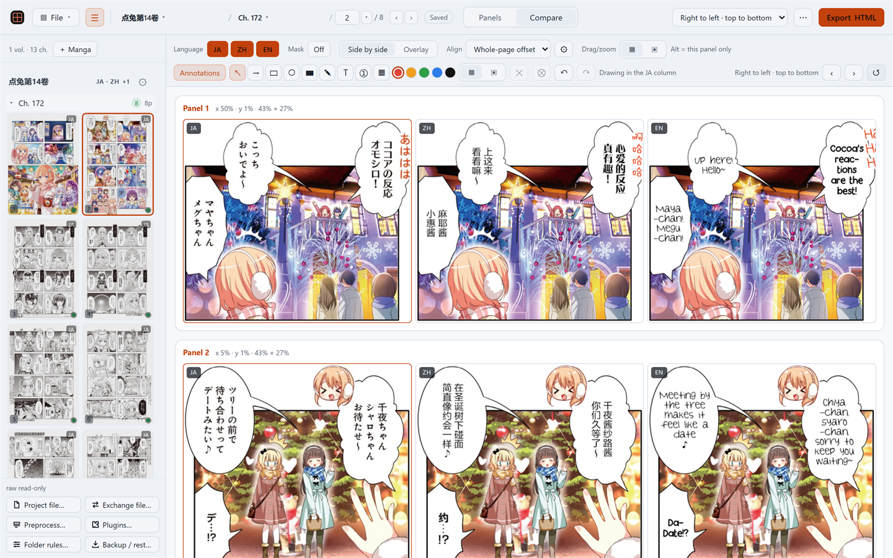

# Compare Reader

The compare reader puts the same panel from two or three languages next to each other — or on top of each other — and lets you align the artwork so the comparison is honest.

<figure class="shot">
  
  <figcaption>Side-by-side mode with three languages. Each language is its own pane; alignment is stored per page and applied to exports.</figcaption>
</figure>

## The problem it solves

Two editions of the same book rarely share exact geometry: scans are shifted, cropped or scaled differently. Comparing a page as a whole hides small differences. Comparing **one panel at a time**, with each language independently aligned, makes wording, tone and omissions visible.

## Layouts

| Control | Behaviour |
| --- | --- |
| **JA / ZH / EN** chips | Toggle a language on or off. A language missing on this page is disabled with a tooltip. |
| Drag a chip | Reorders the panes. The order is remembered. |
| `↺` | Restores the default language order (JA, ZH, EN). |
| **Side by side** | One column per selected language. On a narrow window the panes stack vertically. |
| **Overlay** | All selected languages are drawn in the same box. |
| **Multiply** (Overlay only) | Multiplies the layers so line art shows through. |
| **Aligning** chips (Overlay only) | Chooses which language you are dragging, so two panes never move at once. |

## Masking

Masking hides a language's artwork while you test your own comprehension.

| Control | Behaviour |
| --- | --- |
| **Mask: On / Off** | Master switch. `H` toggles it; `Shift+H` reveals everything. |
| Per-language `◐` / `◯` chips | Choose which languages are masked. |
| **Mask style** | **Blur** or **Solid**. |
| **Mask all** | Re-masks every currently visible pane. |
| **Reveal all** | Turns the master switch off. |
| **Defaults…** | Remembers which languages start masked, across sessions. |
| Click a masked pane | Reveals it temporarily; click the artwork again to mask it. |

Masks are a **reading preference only**. HTML and PNG exports never include masks. Mask defaults are stored in the browser, not in the page JSON.

## Zoom, pan and scope

- **Wheel** over a pane zooms that language. The wheel is captured only while the pointer is inside a pane, so normal page scrolling still works elsewhere.
- **Drag** a pane to pan it.
- **Drag/zoom** scope has two modes: **Whole page** and **This panel**.
- Hold `Alt` while dragging or scrolling to adjust only the current panel, whatever the default scope is.
- **Previous panel / Next panel** move the focused panel without leaving the view.
- **Reset all** clears offsets in the current scope.

Each language has `{ x, y, scale }`. `x` and `y` are fractions of the panel width and height; `scale` zooms the crop between 0.5× and 3×.

## Alignment modes

Alignment is stored in the page JSON, never baked into the images.

| Mode | Behaviour | Good for |
| --- | --- | --- |
| **Whole-page offset** | Dragging any panel translates the whole page for that language. | A whole scan is shifted by the same amount. |
| **Per-panel offset** | Each panel has its own offset. | Digital and print editions have different panel positions. |
| **Anchor alignment** | Click a feature point on the reference language, then the same point on another language; the offset is computed. | Precise, repeatable alignment of one detail. |
| **Grid snap** | Dragging snaps to a step of 0.5%, 1%, 2% or 5%. | Tidy, reproducible numeric offsets. |

Anchor mode shows a prompt with the reference language. Click a feature point in any cell first, then the same spot in another cell. **Cancel anchor** clears the pending point. The pending anchor is not saved.

### Alignment settings

**Alignment settings** opens a panel with:

- The **target** language chips.
- Exact **X**, **Y** and **Scale** inputs for the selected target.
- **Reset all panels on this page** — clears per-panel offsets; whole-page offsets are unaffected.
- **Reset current panel** — clears per-panel offsets for the selected panel only.
- **Save as page preset** / **Save as chapter preset** — stores the current alignment under `data/presets/align.json`.
- Choose a preset, then **Apply to this page** or **Apply to chapter**; **Delete** removes it.

Presets record the alignment mode, offsets, panel offsets and grid step. Applying a chapter preset is the fastest way to fix a uniformly shifted scan across a whole chapter.

## A practical comparison loop

1. Open a page in **Compare** (`C`).
2. Enable `JA` + `ZH` (and `EN` if available), in the order you want to read.
3. Choose **Per-panel offset** if the editions differ per panel; otherwise start with **Whole-page offset**.
4. Drag each language's pane until the panel contents line up.
5. Save an alignment preset if the rest of the chapter shares the offset.
6. Switch to **Overlay** with Multiply to spot differences in line art or lettering.
7. Turn on masks to test yourself, then reveal each pane.

## Behaviour details

- Alignment offsets are applied at export time too, so the exported crop matches what you see.
- The reader needs panels first. If a page has none, it shows a hint to visit the panel workbench.
- Switching pages keeps the mask preference but clears temporary reveals.
- Each pane carries a note count; selecting a panel here scopes a new note to that panel in the shared notes column.
- Missing languages show placeholders rather than empty panes.

<figure class="shot">
  

    <strong>Screenshot pending: compare toolbar close-up</strong>
    A cropped screenshot of the language chips, mask controls, alignment modes and scope switch will be added here.
  

  <figcaption>Planned screenshot: compare toolbar with callouts.</figcaption>
</figure>

## Common pitfalls

- **“This page has no panels yet.”** Go to **Panels** (`P`) and run **Auto split**, then come back.
- **I dragged but the other languages moved.** In Overlay mode, check the **Aligning** chip; only the selected language is dragged.
- **Scale drifted.** Per-panel zoom and per-panel offset are stored separately from the whole-page values. Reset the current panel if a test zoom was left behind.
- **The pane jumps while scrolling.** The wheel is captured only inside a pane; move the pointer to the page margin to scroll normally.
- **Masks appear in a screenshot.** Masks are a UI preference and are not part of exports, but a normal screen capture will show them.
- **A chip is greyed out.** That language has no image on this page. Check the library warning or the volume language mapping.

## Missing screenshots

| Figure | Needed for |
| --- | --- |
| compare toolbar close-up | Language order, masks, alignment mode, scope |
| mask defaults popover | Per-language default masks |
| anchor mode step 1 / step 2 | Reference point and computed offset |
| alignment settings panel | Numeric inputs and presets |

## Related

- [Panel Workbench](/guide/panels) — panels must exist first.
- [Notes](/guide/notes) — write down what you notice.
- [Remote Storage & Backup](/guide/remote) — behaviour when an image is not cached locally.
