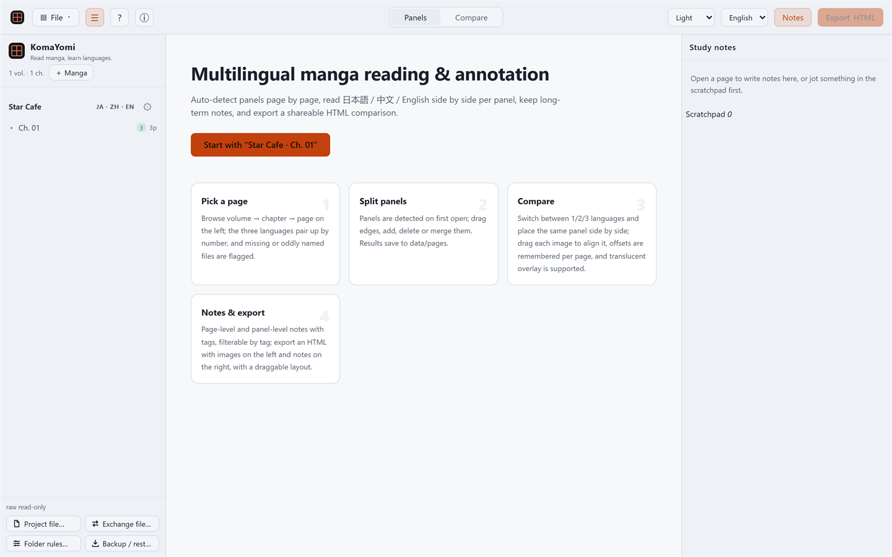

# Library & Import

The library is built by scanning the `raw/` folder each time the app loads. There is no database and no import step that copies your images: **the directory structure is the configuration**.

This page covers how to lay out files, how the scanner pairs languages, how to add a folder that lives somewhere else, and which import dialogs exist.

## The problem it solves

Manga scans arrive in arbitrary folder shapes: `Vol.14/Japanese/ch01`, `点兔第14卷/ja/172`, `manga/zh-cn/172`. You want one shelf that lists volumes and chapters, pairs page 1 of every language with page 1 of every other language, and tells you where a file is missing — without renaming or moving anything.

## Directory shape

```text
raw/
  <volume>/
    <language-dir>/
      <chapter>/
        001.jpg
        002.jpg
```

- A **volume** is any top-level folder under `raw/`.
- A **chapter** is any folder inside a language directory. Chapters are unioned across languages, so one language may be missing a chapter folder.
- **Pages are paired by sorted position, not by filename.** Each language's files are sorted with a natural sort (digit runs compared numerically), then paired by index. `1.jpg`, `2.jpg`, `10.jpg` sorts correctly.

<figure class="shot">
  
  <figcaption>The sidebar lists volume → chapter → pages. Language badges show which languages exist for a volume; warnings appear inline.</figcaption>
</figure>

## Language directory names

The scanner normalizes a folder name (lowercase, spaces and underscores to hyphens) and matches it against aliases:

| Language | Accepted directory names |
| --- | --- |
| Japanese (`ja`) | `ja`, `jp`, `jpn`, `japanese`, `ja-jp`, `日`, `日本語`, `日文` |
| Chinese (`zh`) | `zh`, `zh-cn`, `zh-hans`, `zh-sg`, `cn`, `chs`, `zh-tw`, `zh-hk`, `zh-hant`, `cht`, `tw`, `hk`, `中`, `中文`, `繁中`, `简中` |
| English (`en`) | `en`, `en-us`, `en-gb`, `us`, `uk`, `eng`, `english`, `英`, `英文` |

If a folder name is not recognized, the volume still appears but with a warning. Open **volume settings** (the gear on the volume row) to pin a directory to a language. The choice is stored in `data/library.json`:

```json
{
  "volumes": {
    "点兔第14卷": {
      "dirs": { "ja": "raw-ja", "zh": "raw-zh" }
    }
  }
}
```

A volume may have one, two or three languages. The compare reader only offers languages that actually exist for the current page.

## Adding a folder that lives elsewhere

**＋ Add manga** has two modes:

| Mode | What happens |
| --- | --- |
| Leave the path blank | Creates an empty folder under `raw/`. |
| Pick an existing folder | Creates a **folder link** under `raw/` that points at the original. Images are not copied, and annotations remain writable because the link behaves like a normal folder. |

Optional: give the volume a different display name. The hint under the field repeats the expected layout: `language/chapter/page.jpg`.

**Remove from library** (in volume settings) deletes only the link under `raw/`; images in the original folder are untouched, and annotations already saved under `data/pages/` are kept.

In a plain browser the folder picker is not available. Type the absolute path instead, or use the desktop build and click **Choose a folder…**.

## Page and language roles

Three different "roles" are easy to confuse:

| Role | Where it is chosen | What it affects |
| --- | --- | --- |
| **Base image** | Panel workbench toolbar | Which language's artwork you draw panels on. Panel rectangles are shared by all languages on that page. |
| **Compare languages** | Compare reader language chips | Which languages are displayed, in which order. Not every language has to be enabled. |
| **Primary language** | PNG export | Whole-page and current-panel PNG use the base language; the trilingual collage uses the selected compare languages. |

Panels and notes are stored once per page, not once per language. Alignment offsets are stored per language and, optionally, per panel.

## Warnings you will see

Library warnings are informational; the page still opens.

| Warning | Meaning | Fix |
| --- | --- | --- |
| *No language directory recognized* | None of the subfolders matched an alias. | Map them in volume settings or rename them. |
| *Unrecognized directory: …* | Extra folders sit next to language folders. | Map them, or ignore them. |
| *Page counts differ across languages* | Languages have different numbers of files. | Pairing is by index; add or remove the missing page. |
| *Mixed extensions in this chapter* | e.g. `.jpg` and `.png` alternate. | Usually harmless; normalize if you care about consistent thumbnails. |
| *Filename does not match page number* | The leading number in the filename differs from its sorted position. | Rename if the mismatch indicates a missing or extra page. |

## Folder detection rules

**Folder rules…** (sidebar) lets you describe page paths with placeholders instead of relying on the fixed `volume/language/chapter` shape:

- Placeholders: `series`, `volume`, `chapter`, `language`, `page`.
- `*` matches any single segment; `**` matches an optional segment.
- Rules are tried in order and the first match wins.
- The dialog includes a live preview: how many files and volumes matched, which files were not recognized, and which pages each chapter contains.
- **Fill in the default rules** restores the built-in shape; **Restore defaults** discards your edits.
- **Save rules** rescans the library with the new rules.

Rules only affect detection. They never rename or move files.

## Import, exchange and restore

Four different entry points live in the sidebar. They do different things:

| Entry | Use it for |
| --- | --- |
| **Add manga** | Link an existing image folder into the library. |
| **Project file…** | Export or import a `.mnproj` package (images + annotations + templates + language settings). |
| **Exchange files…** | Move `.mntpl` layout templates, `.mnexp` export templates or a single `.mnpage.json` page. |
| **Backup / restore** | ZIP the `data/` folder, or restore a previous ZIP. |

Imports are validated first and the original files are backed up under `data/backups/`. See [Project Files & Formats](/guide/project-files) for the file contents and version rules.

::: tip Import order
Restore a **backup** when you want your annotations back on the same machine. Import a **project** when you move to another machine. Use **exchange files** when you only want to share a layout, an export style or one page.
:::

## Navigation and performance

| Action | Shortcut |
| --- | --- |
| Previous / next page | `[` / `]` |
| Panel workbench | `P` |
| Compare reader | `C` |
| Toggle sidebar | `S` |
| Toggle notes panel | `N` |
| Open export dialog | `E` |
| Help | `?` |

The URL hash is deep-linkable: `#/<volume>/<chapter>/<page>/<panels|compare>`.

Thumbnails are generated on demand and cached in `data/cache/thumbs/`. Deleting that folder is safe; thumbnails are rebuilt on the next visit. The image format is sniffed from the file header, so a `.png` that is really a JPEG still renders correctly.

## Common pitfalls

- **Renaming a file changes its page position.** Pairing is by sorted index; inserting a page shifts every page after it. Add the new page at the end, or rename the whole chapter consistently.
- **One missing language is not an error.** The page opens, and the compare reader shows a placeholder for the missing language.
- **A folder link is not a copy.** If you move or delete the original folder, the library breaks. Re-add the folder after moving it.
- **WebP is displayed but not decoded for detection.** Use JPEG or PNG when you rely on automatic splitting (see [Panel Workbench](/guide/panels)).
- **The sidebar is the truth.** If a volume or chapter is missing, check the folder name casing and the language aliases before anything else.

## Related

- [Panel Workbench](/guide/panels) — what to do after a page opens.
- [Project Files & Formats](/guide/project-files) — what a `.mnproj` contains.
- [Remote Storage & Backup](/guide/remote) — keeping images on a NAS or WebDAV.
