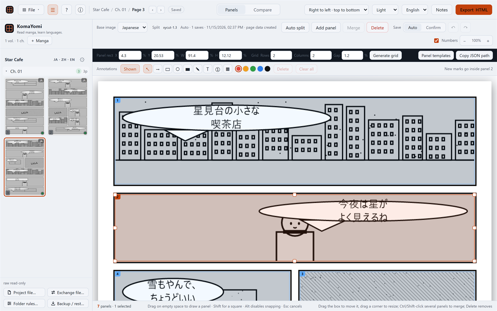
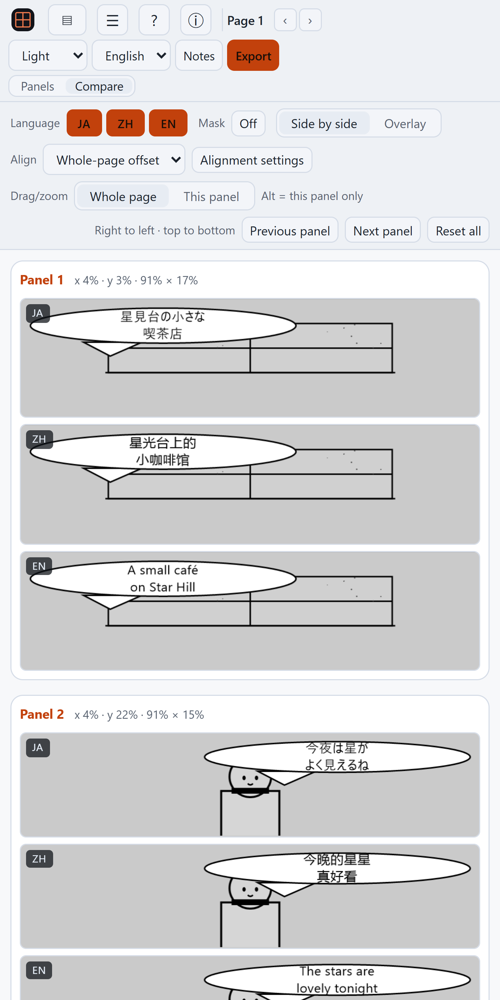
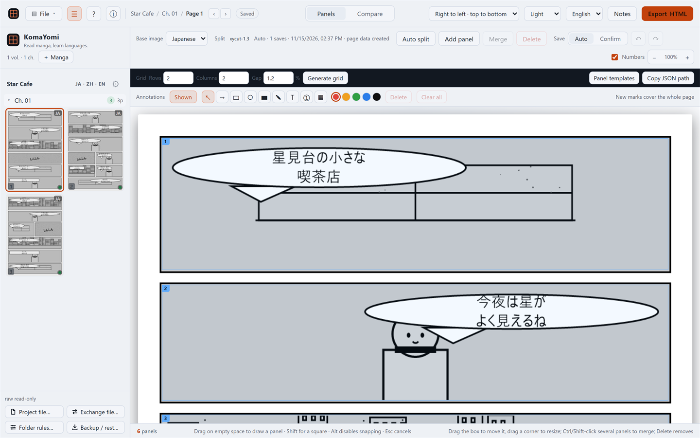

# Introduction

KomaYomi — **Manga Learner** — is a local-first web app for learning languages with manga. You keep the same pages in Japanese, Chinese and English, split the page into panels, read the panels side by side, and write Markdown notes that stay attached to the exact panel they describe.

It is not a manga reader for casual reading and not a distribution platform. Everything runs on your own machine, against your own image folders.

## The problem it solves

A translation is easiest to study panel by panel, not page by page. But scans of the same book in three languages rarely line up: the page is shifted, the panel is cropped differently, the lettering sits somewhere else. A normal image viewer gives you one zoom level, no notes and no way to say "this balloon, in these three editions".

KomaYomi adds the missing middle layer:

1. **Structure** — panels are detected and stored as normalized rectangles, so they survive any zoom or export size.
2. **Alignment** — each language can be nudged independently so the same panel really overlaps.
3. **Notes** — every remark is scoped to a page or a panel, in Markdown, with tags and sources.

## The five-step workflow

| Step | What you do | Page |
| --- | --- | --- |
| 1 | Lay out images as `raw/<volume>/<language>/<chapter>/01.jpg`, or add an existing folder. | [Library & Import](/guide/gallery) |
| 2 | Open a page, let it auto-split, then correct the boxes by hand. | [Panel Workbench](/guide/panels) |
| 3 | Read 2–3 languages side by side or in overlay, align them, mask the ones you are testing. | [Compare Reader](/guide/compare) |
| 4 | Write page and panel notes with tags, sources and screenshots. | [Notes](/guide/notes) |
| 5 | Export a study HTML, PNGs for slides, or a project package for another machine. | [Export](/guide/export) |

## A tour of the screen

<figure class="shot">
  
  <figcaption>The panel workbench. Top bar: page navigation, Panels / Compare, reading order, theme, interface language, Notes and Export. Left: library. Right: notes. Middle: the page with panel boxes.</figcaption>
</figure>

The window has five regions that never move:

- **Top bar** — brand (back to the library), volume / chapter / page, `‹` `›` page arrows, the save indicator, the **Panels / Compare** switch, the reading-direction selector, the UI theme, the interface language, **Notes** and **Export**.
- **Library sidebar** (`S`) — volumes → chapters → pages, with per-page warnings and the entry points for adding a manga, folder rules, project files, exchange files and backup.
- **Stage** — the panel workbench or the compare reader, depending on the view switch.
- **Notes column** (`N`) — page notes, panel notes, overview search and the scratchpad.
- **Pane splitters** — drag the vertical handle between library and stage, or between stage and notes, to resize; double-click to reset.

A page can be in one, two or three languages. The language chips in the compare reader are enabled only for languages that exist on the current page.

## The first ten minutes

1. Start the app (`npm run dev` or the desktop build) and open `http://127.0.0.1:5173`.
2. Put one volume under `raw/` — or click **＋ Add manga** in the sidebar and point it at an existing folder.
3. Click a page in the sidebar. The first open runs automatic panel detection and saves the result to `data/pages/`.
4. Switch to **Compare** (`C`), pick `JA` and `ZH`, and drag one pane until the panels line up.
5. Open **Notes** (`N`), select a panel, and write your first note. Press `Ctrl+Enter` to save.
6. Press `E` to export an HTML file and open it in a browser.

## What is implemented

  
<strong>Library</strong> — scans volumes, recognizes language folder aliases, pairs pages by sorted position, warns about missing pages and naming mismatches.

  
<strong>Panels</strong> — automatic XY-cut detection, add / move / eight-direction resize / merge / delete, numbering, percentage inputs, grid generator, panel templates, declarative layouts, plugins.

  
<strong>Annotations</strong> — arrow, rectangle, ellipse, highlighter, freehand pen, text, number badge and mosaic, page-level visibility switch, PNG export support.

  
<strong>Compare</strong> — 2–3 languages, side-by-side or overlay, per-language blur/solid masks, wheel zoom, pan, page/panel/anchor/grid alignment, saved presets, custom language order.

  
<strong>Notes</strong> — page/panel notes, Markdown with a toolbar and live preview, tags, sources, attached images, overview search, copy-for-LLM, scratchpad.

  
<strong>Export</strong> — HTML (image folder or single file), PNG (whole page, current panel, trilingual collage), panel-border overlay, print styles, export templates.

  
<strong>Storage</strong> — local folders, mounted network shares and WebDAV, with on-demand image fetching and a bounded LRU cache.

  
<strong>Portability</strong> — `.mnproj` project packages, `.mntpl` / `.mnexp` / `.mnpage.json` exchange files, backup and restore ZIPs, versioned schemas.

## What is not implemented

These items are marked <Badge type="warning" text="Planned" /> wherever they appear:

- PDF, Word (`.docx`) and vocabulary-list export.
- An offline write queue and scheduled automatic backups.
- In-app creation and editing of panel groups. The JSON field exists, is preserved on read/write, import and export, but there is no editing UI yet.
- A native mobile app. The web UI does work in a narrow browser window (see below).

<figure class="shot">
  
  <figcaption>Narrow window: panes stack vertically, the library becomes a drawer. This is a responsive web layout, not a native app.</figcaption>
</figure>

## Light and dark

The UI theme follows the system by default and can be fixed to light or dark from the top bar. The exported HTML is light-only, so screenshots and printouts stay consistent.

<figure class="shot">
  
  <figcaption>Light theme.</figcaption>
</figure>

<figure class="shot">
  
  <figcaption>Dark theme.</figcaption>
</figure>

## Common pitfalls

- **Nothing appears in the library.** The sidebar only scans `raw/`; add a folder or mount a remote tree first. See [Library & Import](/guide/gallery).
- **Panels are wrong on the first page.** Detection is a draft, not a verdict. Fix the boxes before writing panel notes; re-running detection later discards hand edits.
- **A language chip is greyed out.** That language has no image on this page. Check page counts and the volume language mapping.
- **Notes seem to disappear on another machine.** Notes live in `data/`, images in `raw/`; move both, or export a `.mnproj`. See [Project Files & Formats](/guide/project-files).
- **An image request fails offline.** Only pages that were opened before going offline are cached. See [Remote Storage & Backup](/guide/remote).

## Where to go next

- New install: [Install & Run](/guide/installation).
- Ready to add images: [Library & Import](/guide/gallery).
- Looking for a key: [Keyboard Shortcuts](/guide/shortcuts).
- Something is wrong: [FAQ & Troubleshooting](/faq).
