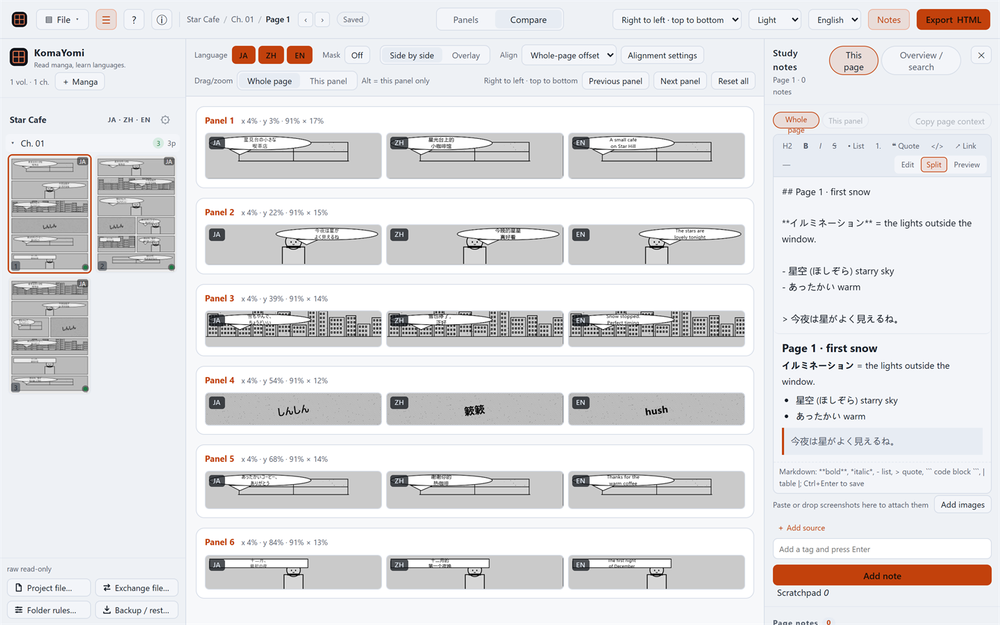

# Notes

Notes are the reason the panels and alignment exist. A note can belong to a whole page or to one panel, it is written in Markdown, and it can carry tags, a source and attached images.

<figure class="shot">
  
  <figcaption>The notes column sits to the right of the stage and can be collapsed. The toolbar above the editor inserts Markdown; the tab bar switches between this page and the global overview.</figcaption>
</figure>

## The problem it solves

A remark like “this translation drops the honorific” is meaningless once it is detached from the balloon it refers to. Notes here are attached to a page or to a panel id, so they survive page reordering, template changes and export. A second problem is retrieval: after fifty pages you need to find every note tagged `语气` or sourced from one article.

## Page notes and panel notes

| Scope | When to use | Stored as |
| --- | --- | --- |
| **Page** | Overall observations, proofreading remarks, questions about a page. | `scope: "page"`, `panelId: null` |
| **Panel** | Wording, tone, a specific balloon, a translation difference. | `scope: "panel"`, `panelId: "<panel id>"` |

Selecting a panel in the workbench or in the compare reader scopes the next note to that panel. With nothing selected, the note is page-scoped. The editor placeholder tells you which scope is active: *Capture this panel's original text…* versus *Capture observations… for the whole page*.

## Writing a note

1. Click the editor in the **This page** tab.
2. Type Markdown. The toolbar inserts the common syntax:

| Button | Inserts |
| --- | --- |
| **B** | Bold (`Ctrl+B`) |
| *I* | Italic (`Ctrl+I`) |
| • List | Bullet list |
| ❝ Quote | Block quote |
| `</>` | Inline code |
| ↗ Link | Link (`Ctrl+K`) |
| H | Heading |
| S | Strikethrough |
| 1. | Ordered list |
| — | Horizontal rule |

3. Choose the mode: **Edit**, **Split** (editor + preview) or **Preview**.
4. Press `Ctrl+Enter` or click **Add note**.

Rendered output escapes raw HTML; HTML is never executed. Notes written before Markdown support still render as plain text with line breaks.

## Tags

- Type a tag and press `Enter` to add it.
- Tags are stored as an array on the note.
- Usage is aggregated across all pages and offered as suggestions, and the **Filter** row can filter the current page by tag.

Tags are the cheapest way to build a personal taxonomy: `语气`, `误译`, `文化`, `待确认`, `拟声词`.

## Attached images

A note can carry screenshots — useful for a reference page, an edition comparison or a photo of a printed book.

- **Paste** an image into the editor, or **drag and drop** it onto the note form.
- **Add images** opens a file picker; each attached image gets a thumbnail with a remove button.
- Images under 400 KB are stored as-is (data URL). Larger images are downscaled to a maximum edge of 1600 px and re-encoded as WebP at quality 0.85.
- Images are stored inside the note's `images` array in the page JSON, so they travel with the page in exports and project files. Very large collections make the JSON bigger; prefer a few cropped references over full pages.

## Sources

Each note can carry a source:

- **URL** — paste a link. The first URL in the note text is filled in automatically. **Fetch title** tries to read the page title with a 5-second timeout; if fetching is blocked, type the title yourself.
- **Free text** — e.g. `ChatGPT conversation 2026-05-12`, a book title or an interview name.

The source is displayed under the note and can be toggled with **Hide source**.

## Copy context for an LLM

**Copy page context** / **Copy context** assembles a prompt from the current page, the selected panel, the note text, tags and sources.

- The copy dialog has an editable **Template prefix**.
- Supported placeholders: `{volume}`, `{chapter}`, `{page}`, `{panel}`, `{notes}`, `{text}`, `{tags}`.
- Edits to the template are remembered automatically.
- **Preview** shows exactly what will be copied; **Copy** puts it on the clipboard.

The default template asks the model to explain language points, tone and cultural background, and to point out misunderstandings. Adjust it once for your preferred tutor style and every later copy follows it.

## Overview and search

The **Overview / search** tab works across the whole library, not just the current page:

- Search text in notes, tags and sources.
- Filter by volume, chapter, page number, tag or source.
- Group results by chapter, tag or source.
- The result header reports how many notes were found across how many pages.
- Click a result to jump to that page and, when the note is panel-scoped, to that panel.

**Clear filters** resets the current query.

## Scratchpad

The scratchpad is for thoughts that arrive before you know where they belong.

1. Type in **Scratchpad** and press `Ctrl+Enter` or **Save**.
2. Later, use **Move to page** or **Move to panel** to file it as a real note.

## Editing and deleting

Each saved note has **Edit**, **Copy context**, **Filter by tag** and delete actions. The **Rendered / Source** toggle on a note switches between the rendered Markdown and its raw text. Deleting a panel deletes its panel-scoped notes, so use page notes for anything you want to keep independent of the layout.

## Common pitfalls

- **The note went to the wrong scope.** Check the sentence above the editor: it names the panel number or says *whole page*. Deselect the panel to write a page note.
- **`Ctrl+Enter` did nothing.** Focus must be inside the note editor; the shortcut does not fire from the search field.
- **A pasted screenshot is huge.** Images over the limit are downscaled automatically, but full-page screenshots are still heavy; crop first.
- **A tag filter hides notes.** The **Filter** row is per page and is not the same as the overview filters.
- **Text looks like code.** Fenced blocks need three backticks on their own lines.

<figure class="shot">
  

    <strong>Screenshot pending: note editor with toolbar and attached image</strong>
    A close-up of the Markdown toolbar, tag row and image thumbnails will be added here.
  

  <figcaption>Planned screenshot: editor toolbar, tags and attachments.</figcaption>
</figure>

## Missing screenshots

| Figure | Needed for |
| --- | --- |
| note editor close-up | Markdown toolbar, tags, attachments |
| overview search | Filters, grouping and jump-to-page |
| copy-context dialog | Template prefix and preview |

## Related

- [Compare Reader](/guide/compare) — where most notes are born.
- [Export](/guide/export) — how notes become a study document.
- [Keyboard Shortcuts](/guide/shortcuts) — editor and global keys.
