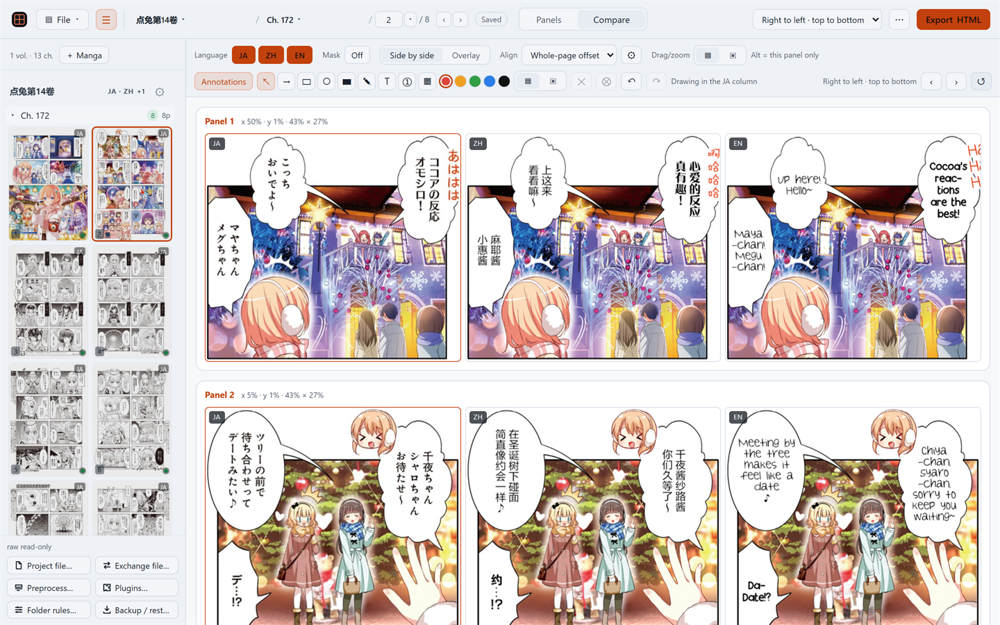

# 比較リーダー

比較リーダーは、2〜3言語の同じコマを並べて、または重ねて表示し、比較が正確になるように絵を位置合わせできる機能です。

<figure class="shot">
  
  <figcaption>3言語の並列モード。言語ごとに独立したペインで、位置合わせはページごとに保存され、エクスポートにも適用されます。</figcaption>
</figure>

## 解決する課題

同じ本の2つの版が正確に同じ形状を持つことはほとんどありません。スキャンは位置、切り取り、倍率が異なります。ページ全体を比較すると、小さな違いは隠れてしまいます。**コマを1つずつ**、言語ごとに独立して位置合わせしながら比較すると、言い回し、語気、省略が見えてきます。

## レイアウト

| コントロール | 動作 |
| --- | --- |
| **JA / ZH / EN** チップ | 言語をオン / オフにします。このページにない言語は、ツールチップ付きで無効になります。 |
| チップをドラッグ | ペインの順序を変更します。順序は記憶されます。 |
| `↺` | 既定の言語順（JA、ZH、EN）に戻します。 |
| **並列** | 選択した言語ごとに1列。狭いウィンドウではペインが縦に積み重なります。 |
| **重ね表示** | 選択したすべての言語を同じ枠に描画します。 |
| **乗算**（重ね表示のみ） | レイヤーを乗算し、線画が透けて見えるようにします。 |
| **位置合わせ対象** チップ（重ね表示のみ） | ドラッグする言語を選び、2つのペインが同時に動かないようにします。 |

## マスク

マスクは、自分の理解度を試す間、その言語の画像を隠します。

| コントロール | 動作 |
| --- | --- |
| **マスク：オン / オフ** | 全体の切り替え。`H` で切り替え、`Shift+H` ですべて表示します。 |
| 言語ごとの `◐` / `◯` チップ | マスクする言語を選びます。 |
| **マスク表示** | **ぼかし** または **塗りつぶし**。 |
| **全マスク** | 現在表示中のすべてのペインをマスクします。 |
| **全表示** | 全体の切り替えをオフにします。 |
| **既定…** | セッションをまたいで、最初からマスクする言語を記憶します。 |
| マスク中のペインをクリック | 一時的に表示します。もう一度絵をクリックするとマスクに戻ります。 |

マスクは**読むときの好み**にすぎません。HTML と PNG のエクスポートにマスクは含まれません。マスクの既定値はページ JSON ではなくブラウザに保存されます。

## ズーム、パン、範囲

- ペイン上での**ホイール**はその言語を拡大縮小します。ホイールはポインターがペイン内にある間だけ捕捉されるため、それ以外の場所では通常のページスクロールが使えます。
- ペインを**ドラッグ**するとパンします。
- **ドラッグ/拡大縮小** の範囲には **ページ全体** と **このコマ** の2つのモードがあります。
- 既定の範囲にかかわらず、ドラッグやスクロール中に `Alt` を押すと現在のコマだけを調整できます。
- **前のコマ / 次のコマ** は、表示を離れずにフォーカス中のコマを移動します。
- **すべてリセット** は現在の範囲のオフセットを消去します。

各言語は `{ x, y, scale }` を持ちます。`x` と `y` はコマの幅と高さに対する比率で、`scale` は切り取り範囲を0.5倍から3倍に拡大縮小します。

## 位置合わせモード

位置合わせはページ JSON に保存され、画像に焼き込まれることはありません。

| モード | 動作 | 向いている場面 |
| --- | --- | --- |
| **ページ全体のオフセット** | どのコマをドラッグしても、その言語のページ全体が平行移動します。 | スキャン全体が同じ量だけずれている場合。 |
| **コマごとのオフセット** | コマごとに個別のオフセットを持ちます。 | 電子版と紙版でコマの位置が違う場合。 |
| **アンカー合わせ** | 基準言語の特徴点をクリックし、別の言語の同じ点をクリックすると、オフセットが計算されます。 | 1つの細部を正確に、再現性をもって位置合わせする場合。 |
| **グリッド吸着** | ドラッグ時に0.5%、1%、2%、5%のステップに吸着します。 | 数値が整い、再現できるオフセットが必要な場合。 |

アンカーモードでは、基準言語を示すプロンプトが表示されます。まず任意のセルで特徴点をクリックし、次に別のセルで同じ位置をクリックします。**基準点をキャンセル** は保留中の点を消去します。保留中のアンカーは保存されません。

### 位置合わせ設定

**位置合わせ設定** を開くと、次のパネルが表示されます。

- **対象** の言語チップ。
- 選択した対象の正確な **X**、**Y**、**拡大率** 入力。
- **このページの全コマをリセット** — コマごとのオフセットを消去します。ページ全体のオフセットは影響を受けません。
- **現在のコマをリセット** — 選択中のコマのコマごとのオフセットだけを消去します。
- **ページプリセットとして保存** / **話プリセットとして保存** — 現在の位置合わせを `data/presets/align.json` に保存します。
- プリセットを選択して **このページに適用** または **話全体に適用**。**削除** で削除します。

プリセットには位置合わせモード、オフセット、コマごとのオフセット、グリッドのステップが記録されます。話プリセットを適用するのが、話全体にわたって一様にずれたスキャンを修正する最速の方法です。

## 実用的な比較の流れ

1. **比較読み**（`C`）でページを開きます。
2. `JA` + `ZH`（あれば `EN` も）を、読みたい順に有効にします。
3. 版によってコマごとに違いがあるなら **コマごとのオフセット** を選び、そうでなければ **ページ全体のオフセット** から始めます。
4. コマの内容がそろうまで、各言語のペインをドラッグします。
5. 話の残りも同じオフセットなら、位置合わせプリセットを保存します。
6. **乗算** 付きの **重ね表示** に切り替え、線画や文字の違いを探します。
7. マスクをオンにして自分を試し、その後ペインを順に表示します。

## 動作の詳細

- 位置合わせのオフセットはエクスポート時にも適用されるため、書き出した切り取り範囲は見た目と一致します。
- リーダーにはまずコマが必要です。コマがないページでは、コマ分割ワークベンチへ行くようヒントが表示されます。
- ページを切り替えると、マスクの設定は保持されますが、一時的な表示は解除されます。
- 各ペインにはノート件数が表示されます。ここでコマを選ぶと、共有のノート列で新しいノートがそのコマに紐付きます。
- 画像のない言語は、空のペインではなくプレースホルダーを表示します。

<figure class="shot">
  

    <strong>スクリーンショット未掲載：比較ツールバーの拡大</strong>
    言語チップ、マスクのコントロール、位置合わせモード、範囲の切り替えを切り出したスクリーンショットを、ここに追加する予定です。
  

  <figcaption>掲載予定：吹き出しを付けた比較ツールバー。</figcaption>
</figure>

## よくある落とし穴

- **「このページにはまだコマがありません。」** **コマ**（`P`）に移動して **自動分割** を実行し、戻ってください。
- **ドラッグしたら他の言語も動いた。** 重ね表示モードでは **位置合わせ対象** のチップを確認してください。ドラッグされるのは選択中の言語だけです。
- **拡大率がずれた。** コマごとのズームとコマごとのオフセットは、ページ全体の値とは別に保存されます。試しに拡大したままなら、現在のコマをリセットしてください。
- **スクロール中にペインが動く。** ホイールはペイン内でのみ捕捉されます。通常どおりスクロールするには、ポインターをページの余白へ移動してください。
- **スクリーンショットにマスクが写る。** マスクは UI の設定でありエクスポートには含まれませんが、通常の画面キャプチャには写ります。
- **チップが灰色になっている。** その言語の画像がこのページにありません。ライブラリの警告か、巻の言語マッピングを確認してください。

## スクリーンショット未掲載

| 図 | 必要な箇所 |
| --- | --- |
| 比較ツールバーの拡大 | 言語順、マスク、位置合わせモード、範囲 |
| マスク既定値のポップオーバー | 言語ごとの既定マスク |
| アンカーモードの手順1 / 手順2 | 基準点と計算されたオフセット |
| 位置合わせ設定ダイアログ | 数値入力とプリセット |

## 関連項目

- [コマ分割ワークベンチ](/ja/guide/panels) — まずコマが必要です。
- [ノート](/ja/guide/notes) — 気づいたことを書き留めます。
- [リモート保存とバックアップ](/ja/guide/remote) — 画像がローカルにキャッシュされていない場合の動作。
