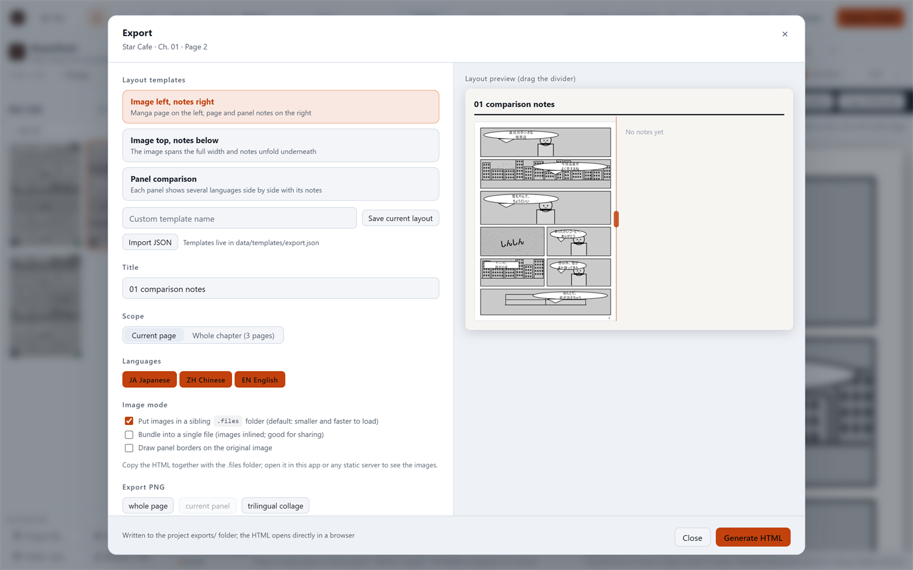

# エクスポート

エクスポートは、コマとノートの集まりを、読める・印刷できる・共有できる形に変えます。学習用の HTML ドキュメント、スライド用の PNG 画像、別のマシン用のプロジェクトパッケージです。

<figure class="shot">
  
  <figcaption>エクスポートダイアログ。左の列でドキュメントを設定し、右側でレイアウトをプレビューします。区切り線をドラッグすると幅を変更できます。</figcaption>
</figure>

## 解決する課題

ノートはアプリの中に、コマに紐付いて存在します。タブレットで見直したり、印刷したり、比較をスライドに貼ったりするには、ページ画像と対応するノートを一緒に保った可搬な成果物が必要です。しかも、何もアップロードせずに。

## ダイアログを開く

`E` を押すか、上部バーの **エクスポート** をクリックします。ダイアログは常に、表示中のページまたは話をエクスポートします。

## HTML エクスポート

### タイトルと範囲

| コントロール | 動作 |
| --- | --- |
| **タイトル** | ドキュメントのタイトル。推奨ファイル名にも使われます。 |
| **現在のページ** | 開いているページだけをエクスポートします。 |
| **話全体（n ページ）** | 話の中で注釈のあるすべてのページをエクスポートします。 |
| **ノートのあるページだけ** | ノートのないページを飛ばします。学習ノートのまとめに便利です。 |
| **言語** | ドキュメントに表示する言語。 |

### 画像の扱い

| モード | 動作 |
| --- | --- |
| **同名の `.files` フォルダ**（既定） | HTML は隣のフォルダの画像を参照します。軽く、読み込みも速くなります。両方を一緒にコピーしてください。 |
| **単一ファイルにまとめる** | 画像を data URL として埋め込みます。共有するファイルは1つですが、話全体では数十 MB になることがあります。 |

**原画にコマ枠を描く** は、エクスポートする原画にコマの矩形を重ねます。これは注釈とは独立しています。

**これらのタグを含む注釈だけ書き出す** はタグでノートを絞り込み、**絞り込みを解除** は選択を解除します。

### レイアウト

組み込みのレイアウトテンプレートは3つあります。

| テンプレート | 結果 |
| --- | --- |
| **左画像・右注釈** | 左に漫画ページ、右にページとコマのノート。 |
| **上画像・下注釈** | 画像が全幅に広がり、ノートが下に展開されます。 |
| **コマ比較** | 各コマに複数言語を並べ、そのノートを添えます。 |

レイアウトテンプレートは任意の名前で保存し、JSON としてエクスポートし、再びインポートできます。`data/templates/export.json` に保存されます。レイアウトのコントロールは次のとおりです。

| コントロール | 効果 |
| --- | --- |
| **画像列の幅** | 画像列の幅（パーセント）。 |
| **列の間隔** | 画像とノートの間隔。 |
| **文字サイズ** | ドキュメントの基本フォント倍率。 |
| **1行あたりの列数** | 1行に並べるページブロックの数。 |

レイアウトは自動で記憶されます。ライブプレビューの区切り線をドラッグして画像幅を設定することもできます。

### 生成

1. 範囲、言語、画像の扱い、レイアウトを選びます。
2. **HTML を生成** をクリックします。
3. 完了すると、エクスポートしたページ数とファイルの場所が表示されます。
4. **HTML を開く** でブラウザで開くか、**HTML をダウンロード** でコピーを保存します。既定の画像モードでは、`.files` フォルダも一緒にコピーしてください。

ファイルはプロジェクトの `exports/` フォルダに書き出されます。HTML はディスクから直接開けます。

### 印刷

生成された HTML には印刷用スタイルが含まれます。背景は削除され、ページ幅は制限されず、ページブロックは画像の途中で分割されません。ブラウザでファイルを開き、通常の **印刷** コマンドで、ブラウザの印刷ダイアログから PDF を作成してください。

::: tip PDF への印刷
現在 PDF を得る正式な方法は、ブラウザの「PDF として保存」です。ネイティブの PDF エクスポーターは実装されていません。[プロジェクトファイルと形式](/ja/guide/project-files) を参照してください。
:::

## PNG エクスポート

**PNG を書き出し** セクションは、ドキュメントを介さずに画像を生成します。

| モード | 内容 |
| --- | --- |
| **ページ全体** | コマ枠と注釈を付けたページ画像。 |
| **現在のコマ** | 選択したコマを切り取り、位置合わせした画像。 |
| **3言語コラージュ** | 同じコマ（コマを選択していない場合はページ全体）について、選択した言語を並べた画像。 |

オプション:

- **注釈を含める（n）** — 注釈レイヤーを PNG に描画します。件数は含まれるマークの数を示します。
- ページ全体と現在のコマの PNG は **優先言語（下地画像）** を使い、コラージュは選択した比較言語を使います。
- **現在のコマ** は、ワークベンチでコマを選択するまで無効です。

PNG はブラウザで生成され、ブラウザのダウンロードフォルダに保存されます。スライド、文書、チャットにそのまま貼れます。

## エクスポートテンプレート

エクスポートテンプレート（`.mnexp`）はレイアウトとスタイルの設定を保存し、同じ見た目を再利用・共有できるようにします。テンプレートのエクスポートとインポートは、サイドバーの **交換ファイル…** から行います。インポートしたテンプレートは検証され、元のファイルは `data/backups/exchange/` にバックアップされます。

## よくある落とし穴

- **HTML の画像が壊れている。** 既定のモードでは、`.files` フォルダを HTML と一緒に移動する必要があります。一緒に移動してください。
- **単一ファイルのエクスポートが巨大になる。** 想定どおりです。すべての画像が埋め込まれます。話全体には `.files` モードを使ってください。
- **エクスポートにページが出てこない。** ノートがなく **ノートのあるページだけ** がオンになっているか、選択した言語の画像がないページです。
- **PNG にコマ枠がない。** PNG エクスポートは注釈の切り替えを使います。**注釈を含める** を有効にしてください。コマ枠は注釈ではなくコマの矩形から描かれる点に注意してください。
- **印刷結果が切れる。** ブラウザの印刷倍率を「ページに合わせる」にし、網掛けが必要な場合だけ背景のグラフィックを有効にしてください。
- **出力フォルダに書き込めない。** パッケージ化したデスクトップ版では、`exports/` は選択したライブラリフォルダの中にあります。

<figure class="shot">
  

    <strong>スクリーンショット未掲載：エクスポートした HTML と PNG の結果</strong>
    ブラウザで表示した生成済み HTML と、3つの PNG モードを並べたスクリーンショットを、ここに追加する予定です。
  

  <figcaption>掲載予定：エクスポートしたドキュメントと PNG の出力。</figcaption>
</figure>

## スクリーンショット未掲載

| 図 | 必要な箇所 |
| --- | --- |
| エクスポートした HTML ページ | 2列と縦積みのレイアウト |
| PNG モードの比較 | ページ全体 / コマ / コラージュ |
| エクスポートテンプレートのコントロール | 保存、インポート、適用 |

## 関連項目

- [ノート](/ja/guide/notes) — ドキュメントに入る内容。
- [プロジェクトファイルと形式](/ja/guide/project-files) — プロジェクト全体をエクスポートする場合。
- [キーボードショートカット](/ja/guide/shortcuts) — `E` でこのダイアログが開きます。
