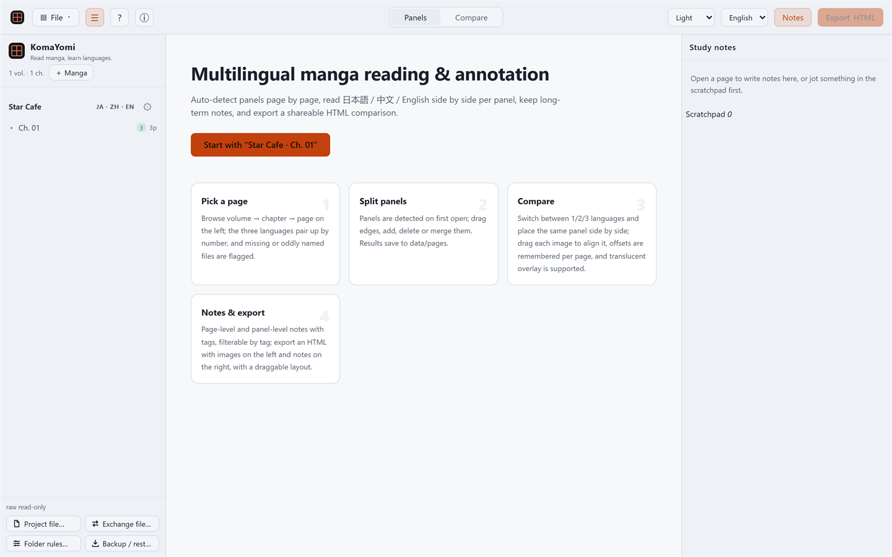

# ライブラリとインポート

ライブラリは、アプリの読み込み時に `raw/` フォルダをスキャンして構築されます。データベースも、画像をコピーするインポート手順もありません。**ディレクトリ構造が設定そのもの** です。

このページでは、ファイルの配置方法、スキャナーが言語を対応付ける方法、別の場所にあるフォルダの追加方法、用意されているインポートダイアログを説明します。

## 解決する課題

漫画のスキャンは、`Vol.14/Japanese/ch01`、`点兔第14卷/ja/172`、`manga/zh-cn/172` のように、さまざまなフォルダ構成で届きます。名前も場所も変えずに、巻と話を一覧できる1つの棚で各言語の1ページ目を対応付け、ファイルの欠落を教えてくれる仕組みが必要です。

## ディレクトリ構成

```text
raw/
  <volume>/
    <language-dir>/
      <chapter>/
        001.jpg
        002.jpg
```

- **巻** は `raw/` 直下の任意のフォルダです。
- **話** は言語ディレクトリ内の任意のフォルダです。話は言語をまたいで統合されるため、ある言語では話フォルダが欠けていることがあります。
- **ページはファイル名ではなく、並べ替えた位置で対応付けられます。** 各言語のファイルを自然順（連続する数字を数値として比較）で並べ替え、そのインデックスで対応付けます。`1.jpg`、`2.jpg`、`10.jpg` も正しく並びます。

<figure class="shot">
  
  <figcaption>サイドバーは 巻 → 話 → ページ の順に表示します。言語バッジは巻に存在する言語を示し、警告はその場に表示されます。</figcaption>
</figure>

## 言語ディレクトリ名

スキャナーはフォルダ名を正規化し（小文字化、空白とアンダースコアをハイフンに変換）、別名と照合します。

| 言語 | 受け付けるディレクトリ名 |
| --- | --- |
| 日本語（`ja`） | `ja`, `jp`, `jpn`, `japanese`, `ja-jp`, `日`, `日本語`, `日文` |
| 中国語（`zh`） | `zh`, `zh-cn`, `zh-hans`, `zh-sg`, `cn`, `chs`, `zh-tw`, `zh-hk`, `zh-hant`, `cht`, `tw`, `hk`, `中`, `中文`, `繁中`, `简中` |
| 英語（`en`） | `en`, `en-us`, `en-gb`, `us`, `uk`, `eng`, `english`, `英`, `英文` |

フォルダ名を認識できない場合、巻は表示されますが警告が付きます。**巻の設定**（巻の行の歯車）を開き、ディレクトリを言語に割り当ててください。この選択は `data/library.json` に保存されます。

```json
{
  "volumes": {
    "点兔第14卷": {
      "dirs": { "ja": "raw-ja", "zh": "raw-zh" }
    }
  }
}
```

1つの巻は1〜3言語を持てます。比較リーダーは、現在のページに実際に存在する言語だけを提示します。

## 別の場所にあるフォルダの追加

**＋ マンガを追加** には2つのモードがあります。

| モード | 動作 |
| --- | --- |
| パスを空欄にする | `raw/` の下に空のフォルダを作成します。 |
| 既存のフォルダを選ぶ | 元のフォルダを指す **フォルダリンク** を `raw/` の下に作成します。画像はコピーされず、リンクは通常のフォルダと同じように動作するため、注釈もそのまま読み書きできます。 |

任意: 巻に別の表示名を付けられます。フィールド下のヒントには、想定される構成 `language/chapter/page.jpg` が表示されます。

**ライブラリから削除**（巻の設定内）は `raw/` の下のリンクだけを削除します。元のフォルダの画像はそのまま残り、`data/pages/` に保存済みの注釈も保持されます。

通常のブラウザではフォルダ選択ダイアログを開けません。絶対パスを直接入力するか、デスクトップ版で **フォルダを選択…** をクリックしてください。

## ページと言語の役割

混同しやすい3つの「役割」があります。

| 役割 | 指定する場所 | 影響する範囲 |
| --- | --- | --- |
| **下地画像**（基準画像） | コマ分割ワークベンチのツールバー | どの言語の画像にコマを描くか。コマの矩形はそのページの全言語で共有されます。 |
| **比較言語** | 比較リーダーの言語チップ | 表示する言語とその順序。すべての言語を有効にする必要はありません。 |
| **優先言語** | PNG エクスポート | ページ全体と現在のコマの PNG は下地画像の言語を使い、3言語コラージュは選択した比較言語を使います。 |

コマとノートは言語ごとではなく、ページごとに1回だけ保存されます。位置合わせのオフセットは言語ごと、任意でコマごとに保存されます。

## 表示される警告

ライブラリの警告は情報通知です。ページは開けます。

| 警告 | 意味 | 対処 |
| --- | --- | --- |
| *言語ディレクトリが認識されません* | サブフォルダがどの別名にも一致しませんでした。 | 巻の設定で割り当てるか、名前を変更します。 |
| *未認識のディレクトリ：…* | 言語フォルダの隣に余分なフォルダがあります。 | 割り当てるか、無視します。 |
| *言語間でページ数が異なります* | 言語ごとにファイル数が違います。 | 対応付けはインデックス順です。欠けているページを追加するか削除します。 |
| *この話に混在した拡張子があります* | 例：`.jpg` と `.png` が交互にあります。 | 通常は無害です。サムネイルの一貫性が必要なら揃えてください。 |
| *ファイル名がページ番号と一致しません* | ファイル名先頭の数字が並び順と異なります。 | 欠落や余分なページを示す不一致なら、名前を変更します。 |

## フォルダ検出の規則

**ディレクトリ規則…**（サイドバー）では、固定の `volume/language/chapter` 構成に頼らず、プレースホルダーでページパスを記述できます。

- プレースホルダー：`series`、`volume`、`chapter`、`language`、`page`。
- `*` は任意の1セグメント、`**` は任意のセグメント（省略可）に一致します。
- 規則は順に試され、最初に一致したものが使われます。
- ダイアログにはライブプレビューがあり、一致したファイル数と巻数、認識されなかったファイル、各話に含まれるページを確認できます。
- **既定のルールを入力** は組み込みの構成を復元し、**既定に戻す** は編集内容を破棄します。
- **ルールを保存** は新しい規則でライブラリを再スキャンします。

規則は検出にのみ影響します。ファイルの名前変更や移動は行いません。

## インポート、交換、復元

サイドバーには4つの異なる入口があり、それぞれ役割が違います。

| 入口 | 用途 |
| --- | --- |
| **マンガを追加** | 既存の画像フォルダをライブラリにリンクします。 |
| **プロジェクトファイル…** | `.mnproj` パッケージ（画像 + 注釈 + テンプレート + 言語設定）をエクスポートまたはインポートします。 |
| **交換ファイル…** | `.mntpl` レイアウトテンプレート、`.mnexp` エクスポートテンプレート、単一の `.mnpage.json` ページをやり取りします。 |
| **バックアップ / 復元** | `data/` フォルダを ZIP にするか、以前の ZIP を復元します。 |

インポートは最初に検証され、元のファイルは `data/backups/` にバックアップされます。ファイルの内容とバージョンの規則は [プロジェクトファイルと形式](/ja/guide/project-files) を参照してください。

::: tip インポートの順序
注釈を同じマシンに戻したいときは **バックアップ** を復元します。別のマシンへ移るときは **プロジェクト** をインポートします。レイアウト、エクスポートスタイル、1ページだけを共有したいときは **交換ファイル** を使います。
:::

## ナビゲーションとパフォーマンス

| 操作 | ショートカット |
| --- | --- |
| 前 / 次のページ | `[` / `]` |
| コマ分割ワークベンチ | `P` |
| 比較リーダー | `C` |
| サイドバーの表示切り替え | `S` |
| ノート欄の表示切り替え | `N` |
| エクスポートダイアログを開く | `E` |
| ヘルプ | `?` |

URL ハッシュはディープリンクに使えます：`#/<volume>/<chapter>/<page>/<panels|compare>`。

サムネイルはオンデマンドで生成され、`data/cache/thumbs/` にキャッシュされます。このフォルダは削除しても問題なく、次回表示時に再生成されます。画像形式はファイルヘッダーから判定されるため、実際は JPEG の `.png` も正しく表示されます。

## よくある落とし穴

- **ファイル名を変えるとページ位置が変わります。** 対応付けは並べ替えたインデックス順です。ページを挿入すると、それ以降のページがすべてずれます。新しいページは末尾に追加するか、話全体の名前を一貫して変更してください。
- **言語が1つ欠けていてもエラーではありません。** ページは開き、比較リーダーは欠けている言語のプレースホルダーを表示します。
- **フォルダリンクはコピーではありません。** 元のフォルダを移動または削除すると、ライブラリが壊れます。移動後はフォルダを追加し直してください。
- **WebP は表示できますが、検出用にデコードされません。** 自動分割に頼る場合は JPEG または PNG を使用してください（[コマ分割ワークベンチ](/ja/guide/panels) 参照）。
- **サイドバーが正解です。** 巻や話が見つからない場合は、まずフォルダ名の大文字小文字と言語の別名を確認してください。

## 関連項目

- [コマ分割ワークベンチ](/ja/guide/panels) — ページを開いた後にすること。
- [プロジェクトファイルと形式](/ja/guide/project-files) — `.mnproj` に含まれるもの。
- [リモート保存とバックアップ](/ja/guide/remote) — 画像を NAS や WebDAV に置く方法。
