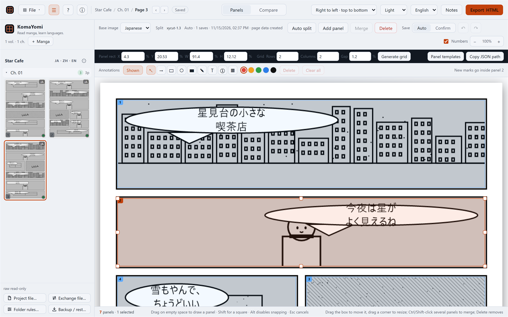
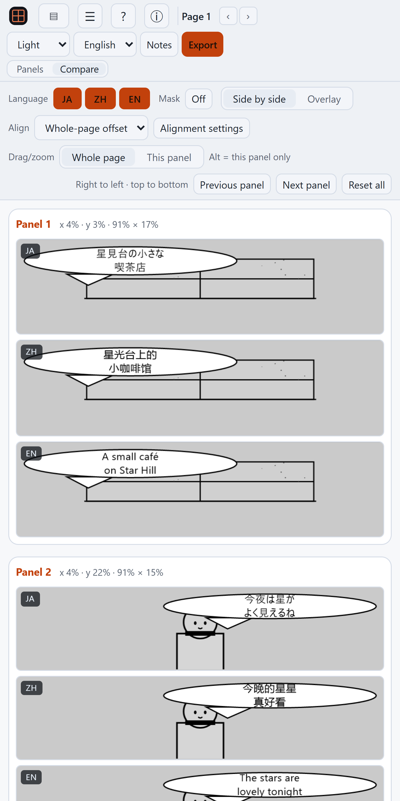
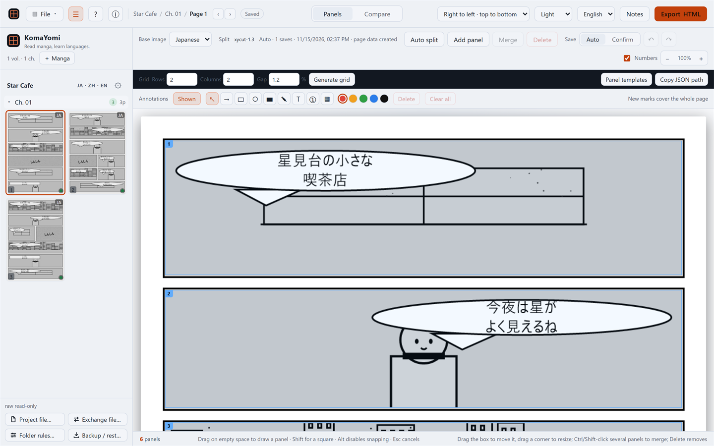
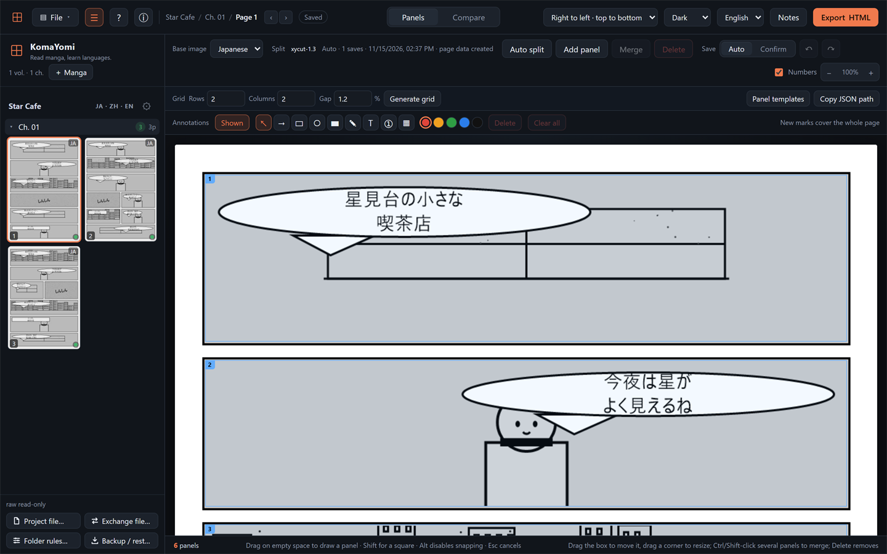

# はじめに

KomaYomi（**Manga Learner**）は、漫画で言語を学ぶためのローカル優先の Web アプリです。同じページを日本語・中国語・英語で持ち、ページをコマに分割し、コマを並べて読み、そのコマに結び付いた Markdown ノートを書けます。

気軽な読書のための漫画リーダーではなく、配信プラットフォームでもありません。すべては自分のマシン上で、自分の画像フォルダを対象に動作します。

## 解決する課題

翻訳は、ページ単位よりもコマ単位で学ぶほうが理解しやすいものです。しかし、同じ本のスキャンを3言語でそろえるのは簡単ではありません。ページがずれ、コマの切り出しが異なり、文字の位置も違います。通常の画像ビューアでは、ズームは1段階だけで、ノートも取れず、「この吹き出しをこの3つの版で」と指定する方法もありません。

KomaYomi は、その間に欠けている層を追加します。

1. **構造** — コマは正規化された矩形として検出・保存されるため、ズームやエクスポートのサイズに左右されません。
2. **位置合わせ** — 言語ごとに個別にずらせるため、同じコマを本当に重ねられます。
3. **ノート** — すべての所見はページまたはコマに紐付き、タグと出典付きの Markdown で残せます。

## 5ステップのワークフロー

| 手順 | 行うこと | ページ |
| --- | --- | --- |
| 1 | 画像を `raw/<volume>/<language>/<chapter>/01.jpg` に配置するか、既存のフォルダを追加します。 | [ライブラリとインポート](/ja/guide/gallery) |
| 2 | ページを開いて自動分割を実行し、枠を手作業で修正します。 | [コマ分割ワークベンチ](/ja/guide/panels) |
| 3 | 2〜3言語を並列または重ね表示で読み、位置合わせを行い、確認したい言語をマスクします。 | [比較リーダー](/ja/guide/compare) |
| 4 | タグ、出典、スクリーンショット付きのページノートとコマノートを書きます。 | [ノート](/ja/guide/notes) |
| 5 | 学習用 HTML、スライド用 PNG、別のマシン用のプロジェクトパッケージをエクスポートします。 | [エクスポート](/ja/guide/export) |

## 画面の構成

<figure class="shot">
  
  <figcaption>コマ分割ワークベンチ。上部バー：ページ移動、コマ / 比較読み、読み順、テーマ、表示言語、ノート、エクスポート。左：ライブラリ。右：ノート。中央：コマ枠付きのページ。</figcaption>
</figure>

ウィンドウには、常に同じ位置にある5つの領域があります。

- **上部バー** — ブランド（ライブラリに戻る）、巻 / 話 / ページ、`‹` `›` のページ矢印、保存インジケーター、**コマ / 比較読み** の切り替え、読み順のセレクター、UI テーマ、表示言語、**ノート**、**エクスポート**。
- **ライブラリサイドバー**（`S`） — 巻 → 話 → ページ。ページごとの警告に加え、マンガの追加、フォルダ規則、プロジェクトファイル、交換ファイル、バックアップへの入口があります。
- **ステージ** — 表示の切り替えに応じて、コマ分割ワークベンチまたは比較リーダーを表示します。
- **ノート列**（`N`） — ページノート、コマノート、一覧検索、一時メモ。
- **ペインスプリッター** — ライブラリとステージの間、またはステージとノートの間の縦ハンドルをドラッグしてサイズを変更します。ダブルクリックで既定値に戻ります。

ページは1〜3言語を持てます。比較リーダーの言語チップは、現在のページに存在する言語だけが有効になります。

## 最初の10分

1. アプリを起動し（`npm run dev` またはデスクトップ版）、`http://127.0.0.1:5173` を開きます。
2. `raw/` に1巻分を置くか、サイドバーの **＋ マンガを追加** をクリックして既存のフォルダを指定します。
3. サイドバーでページをクリックします。初回表示時にコマの自動検出が実行され、結果が `data/pages/` に保存されます。
4. **比較読み**（`C`）に切り替え、`JA` と `ZH` を選び、コマがそろうまでペインをドラッグします。
5. **ノート**（`N`）を開いてコマを選択し、最初のノートを書きます。`Ctrl+Enter` で保存します。
6. `E` を押して HTML をエクスポートし、ブラウザで開きます。

## 実装済みの機能

  
<strong>ライブラリ</strong> — 巻をスキャンし、言語フォルダの別名を認識し、ページを並び順で対応付け、欠けているページや命名の不一致を警告します。

  
<strong>コマ</strong> — XY カットによる自動検出、追加 / 移動 / 8方向のリサイズ / 結合 / 削除、番号付け、パーセント入力、グリッド生成、コマテンプレート、宣言的レイアウト、プラグイン。

  
<strong>注釈</strong> — 矢印、矩形、楕円、マーカー、フリーハンドペン、テキスト、番号バッジ、モザイク、ページ単位の表示切り替え、PNG エクスポート対応。

  
<strong>比較</strong> — 2〜3言語、並列または重ね表示、言語ごとのぼかし / 塗りつぶしマスク、ホイールズーム、パン、ページ / コマ / アンカー / グリッドの位置合わせ、保存済みプリセット、言語順のカスタマイズ。

  
<strong>ノート</strong> — ページ / コマのノート、ツールバーとライブプレビュー付きの Markdown、タグ、出典、添付画像、一覧検索、LLM 用コピー、一時メモ。

  
<strong>エクスポート</strong> — HTML（画像フォルダまたは単一ファイル）、PNG（ページ全体、現在のコマ、3言語コラージュ）、コマ枠の重ね描き、印刷用スタイル、エクスポートテンプレート。

  
<strong>ストレージ</strong> — ローカルフォルダ、マウントしたネットワーク共有、WebDAV。オンデマンドの画像取得と上限付き LRU キャッシュに対応します。

  
<strong>可搬性</strong> — `.mnproj` プロジェクトパッケージ、`.mntpl` / `.mnexp` / `.mnpage.json` の交換ファイル、バックアップと復元の ZIP、バージョン付きスキーマ。

## 未実装の機能

以下の項目は、登場する箇所で <Badge type="warning" text="予定" /> と表示されます。

- PDF、Word（`.docx`）、語彙リストのエクスポート。
- オフラインの書き込みキューと定期的な自動バックアップ。
- アプリ内でのコマグループの作成と編集。JSON フィールドは存在し、読み書き・インポート・エクスポートで保持されますが、編集 UI はまだありません。
- ネイティブのモバイルアプリ。Web UI は狭いブラウザウィンドウでも動作します（下記参照）。

<figure class="shot">
  
  <figcaption>狭いウィンドウ：ペインは縦に積み重なり、ライブラリはドロワーになります。これはレスポンシブな Web レイアウトであり、ネイティブアプリではありません。</figcaption>
</figure>

## ライトとダーク

UI テーマは既定でシステムに従い、上部バーからライトまたはダークに固定できます。エクスポートされる HTML はライトテーマのみなので、スクリーンショットや印刷結果が一定になります。

<figure class="shot">
  
  <figcaption>ライトテーマ。</figcaption>
</figure>

<figure class="shot">
  
  <figcaption>ダークテーマ。</figcaption>
</figure>

## よくある落とし穴

- **ライブラリに何も出ない。** サイドバーは `raw/` だけを走査します。先にフォルダーを追加するか、リモートツリーをマウントしてください。[ライブラリと取り込み](/ja/guide/gallery) を参照。
- **最初のページのコマがずれている。** 自動検出は下書きで、結論ではありません。コマ単位のノートを書く前に枠を直してください。あとで再検出すると手作業の修正は失われます。
- **言語チップが灰色。** そのページにその言語の画像がありません。ページ数と言語の対応付けを確認してください。
- **別のマシンでノートが消えたように見える。** ノートは `data/`、画像は `raw/` にあります。両方を移すか、`.mnproj` を書き出してください。[プロジェクトファイルと形式](/ja/guide/project-files) を参照。
- **オフラインで画像取得に失敗する。** オフライン前に開いたページだけがキャッシュされています。[バックアップとリモート](/ja/guide/remote) を参照。

## 次に読む

- 新規インストール：[インストールと起動](/ja/guide/installation)。
- 画像を追加する：[ライブラリと取り込み](/ja/guide/gallery)。
- キーを探す：[ショートカット一覧](/ja/guide/shortcuts)。
- 問題が起きた：[FAQ とトラブルシューティング](/ja/faq)。
