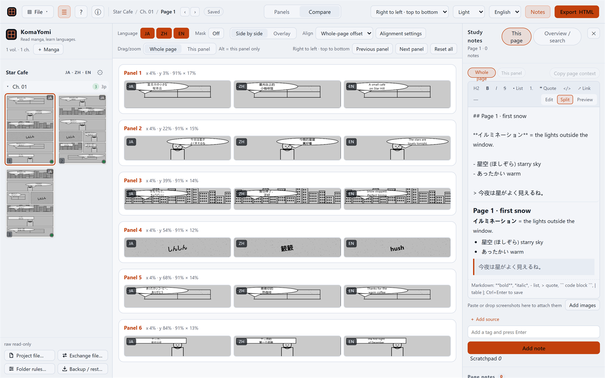

# ノート

ノートは、コマと位置合わせが存在する理由です。ノートはページ全体または1つのコマに属し、Markdown で書き、タグ、出典、添付画像を持てます。

<figure class="shot">
  
  <figcaption>ノート列はステージの右側にあり、折りたたむことができます。エディター上のツールバーは Markdown を挿入し、タブバーでこのページと全体の一覧を切り替えます。</figcaption>
</figure>

## 解決する課題

「この翻訳は敬称を落としている」といった所見は、参照している吹き出しから切り離されると意味をなしません。ここではノートはページまたはコマの id に紐付くため、ページの並べ替え、テンプレートの変更、エクスポートを越えて残ります。2つ目の課題は検索です。50ページを超えると、`语气` タグの付いたノートや、ある記事を出典とするノートをすべて見つける必要があります。

## ページノートとコマノート

| 範囲 | 使う場面 | 保存形式 |
| --- | --- | --- |
| **ページ** | 全体の所見、校正の指摘、ページについての疑問。 | `scope: "page"`、`panelId: null` |
| **コマ** | 言い回し、語気、特定の吹き出し、翻訳の違い。 | `scope: "panel"`、`panelId: "<panel id>"` |

ワークベンチまたは比較リーダーでコマを選択すると、次のノートはそのコマに紐付きます。何も選択していない場合、ノートはページ単位になります。エディターのプレースホルダーが有効な範囲を示します。*このコマの原文、訳の違い、語気などを記録…* と *ページ全体の気づき、疑問、校正メモなどを記録…* です。

## ノートを書く

1. **このページ** タブのエディターをクリックします。
2. Markdown を入力します。ツールバーがよく使う記法を挿入します。

| ボタン | 挿入内容 |
| --- | --- |
| **B** | 太字（`Ctrl+B`） |
| *I* | 斜体（`Ctrl+I`） |
| • リスト | 箇条書き |
| ❝ 引用 | 引用ブロック |
| `</>` | インラインコード |
| ↗ リンク | リンク（`Ctrl+K`） |
| H | 見出し |
| S | 取り消し線 |
| 1. | 番号付きリスト |
| — | 区切り線 |

3. モードを選びます。**編集**、**分割**（エディター + プレビュー）、**プレビュー** です。
4. `Ctrl+Enter` を押すか、**ノートを追加** をクリックします。

レンダリングされた出力は生の HTML をエスケープするため、HTML が実行されることはありません。Markdown 対応前に書かれたノートは、改行を保ったプレーンテキストとして表示されます。

## タグ

- タグを入力して `Enter` を押すと追加されます。
- タグはノート上の配列として保存されます。
- 使用状況はすべてのページから集計されて候補として提示され、**絞り込み** の行で現在のページをタグで絞り込めます。

タグは、自分用の分類を作るもっとも手軽な方法です。`语气`、`误译`、`文化`、`待确认`、`拟声词` などがあります。

## 添付画像

ノートにはスクリーンショットを添付できます。参照ページ、版の比較、紙の本の写真などに便利です。

- エディターに画像を**貼り付け**るか、ノートのフォームへ**ドラッグ＆ドロップ**します。
- **画像を追加** でファイル選択を開きます。添付した画像ごとにサムネイルと削除ボタンが付きます。
- 400 KB 未満の画像はそのまま（data URL）保存します。それより大きい画像は長辺1600 px 以下に縮小し、品質0.85の WebP に再エンコードします。
- 画像はページ JSON のノートの `images` 配列に保存されるため、エクスポートやプロジェクトファイルでもページと一緒に移動します。数が非常に多いと JSON が大きくなるので、ページ全体より切り取った参照をいくつか使うことをおすすめします。

## 出典

各ノートは出典を持てます。

- **URL** — リンクを貼り付けます。ノート本文の最初の URL が自動で入力されます。**タイトル取得** は5秒のタイムアウトでページタイトルの読み取りを試みます。取得がブロックされる場合は、タイトルを手入力してください。
- **自由入力** — 例：`ChatGPT conversation 2026-05-12`、書籍名、インタビュー名。

出典はノートの下に表示され、**出典を閉じる** で切り替えられます。

## LLM 用の文脈をコピー

**このページの文脈をコピー** / **文脈をコピー** は、現在のページ、選択中のコマ、ノート本文、タグ、出典からプロンプトを組み立てます。

- コピーダイアログには編集可能な **テンプレート前置き** があります。
- 使用できるプレースホルダー：`{volume}`、`{chapter}`、`{page}`、`{panel}`、`{notes}`、`{text}`、`{tags}`。
- テンプレートの編集内容は自動で記憶されます。
- **プレビュー** はコピーされる内容をそのまま表示し、**コピー** でクリップボードに入れます。

既定のテンプレートは、言語的なポイント、語気、文化的背景の説明と、誤解の指摘をモデルに求めます。好みの講師スタイルに一度合わせれば、以降のコピーはすべてそれに従います。

## 一覧と検索

**一覧 / 検索** タブは、現在のページだけでなくライブラリ全体で動作します。

- ノート本文、タグ、出典のテキストを検索します。
- 巻、話、ページ番号、タグ、出典で絞り込みます。
- 結果を話、タグ、出典でまとめます。
- 結果のヘッダーには、何ページから何件のノートが見つかったかが表示されます。
- 結果をクリックするとそのページへ移動し、コマ単位のノートならそのコマへ移動します。

**絞り込みを解除** は現在のクエリをリセットします。

## 一時メモ

一時メモは、どこに属するか決まる前に浮かんだ考えのための場所です。

1. **一時メモ** に入力し、`Ctrl+Enter` または **メモする** を押します。
2. 後で **このページへ** または **このコマへ** を使って、正式なノートとして整理します。

## 編集と削除

保存済みの各ノートには **編集**、**文脈をコピー**、**タグで絞り込む**、削除の操作があります。ノートの **表示 / ソース** 切り替えで、レンダリングされた Markdown と生のテキストを切り替えます。コマを削除すると、そのコマに紐付くノートも削除されるため、レイアウトに依存せず残したい内容はページノートを使ってください。

## よくある落とし穴

- **ノートが意図しない範囲に入った。** エディター上の文を確認してください。コマ番号が示されているか、*ページ全体* と書かれています。ページノートを書きたいときはコマの選択を解除します。
- **`Ctrl+Enter` が効かなかった。** フォーカスがノートエディター内にある必要があります。検索フィールドではショートカットは動作しません。
- **貼り付けたスクリーンショットが大きすぎる。** 上限を超える画像は自動で縮小されますが、ページ全体のスクリーンショットは依然として重いので、先に切り取ってください。
- **タグの絞り込みでノートが隠れる。** **絞り込み** の行はページ単位のもので、一覧の絞り込みとは別です。
- **テキストがコードのように見える。** コードブロックには、それぞれ独立した行に3つのバッククォートが必要です。

<figure class="shot">
  

    <strong>スクリーンショット未掲載：ツールバーと添付画像付きのノートエディター</strong>
    Markdown ツールバー、タグの行、画像のサムネイルを拡大したものを、ここに追加する予定です。
  

  <figcaption>掲載予定：エディターのツールバー、タグ、添付画像。</figcaption>
</figure>

## スクリーンショット未掲載

| 図 | 必要な箇所 |
| --- | --- |
| ノートエディターの拡大 | Markdown ツールバー、タグ、添付画像 |
| 一覧検索 | 絞り込み、まとめ、ページへの移動 |
| 文脈コピーダイアログ | テンプレート前置きとプレビュー |

## 関連項目

- [比較リーダー](/ja/guide/compare) — ほとんどのノートが生まれる場所。
- [エクスポート](/ja/guide/export) — ノートが学習ドキュメントになるまで。
- [キーボードショートカット](/ja/guide/shortcuts) — エディターと全体のキー。
