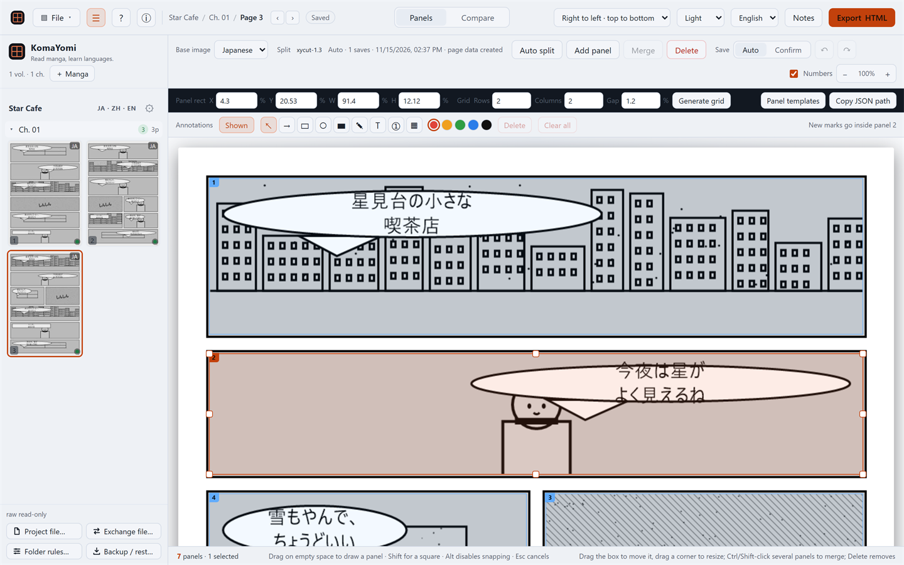

# コマ分割ワークベンチ

コマ分割ワークベンチは、ページを構造化データに変える場所です。自動検出はあくまで出発点にすぎず、ワークベンチはそれをすばやく、取り消し可能な形で修正するために作られています。

<figure class="shot">
  
  <figcaption>検出されたコマは、下地画像の上に番号付きの枠として描画されます。選択中の枠には8つのリサイズハンドルが表示されます。注釈ツールバーはコマのツールの下にあります。</figcaption>
</figure>

## 解決する課題

以降のすべての機能はコマに依存します。比較読み、コマ単位のノート、コマの PNG エクスポート、HTML エクスポートです。枠が誤っていると、後続のすべてが誤ります。自動検出はほとんどのページを正しく処理しますが、扉ページ、見開きページ、端の細い帯、特殊なレイアウトは必ず手作業が必要になります。

## ツールバーの各コントロール

### 1行目 — 下地画像と分割

| コントロール | 動作 | 補足 |
| --- | --- | --- |
| **下地画像** セレクター | 表示し、検出に使う言語の画像を選びます。 | コマの矩形はページの全言語で共有されるため、変わるのは描画の対象となる画像だけです。 |
| 検出器チップ | 現在のコマを生成したアルゴリズムのバージョン（例：`xycut-1.3`、`layout:<id>`、`plugin:<name>`）を表示します。 | `旧データ` は、ページ JSON がバージョン追跡より前のものであることを示します。 |
| 状態テキスト | コマが *自動*、*テンプレート適用*、*プラグイン適用*、*手動編集* のどれか、保存回数、最後の編集概要を表示します。 | これは編集カウンターであり、監査ログではありません。 |
| **自動分割** | 下地画像に対して検出を実行し、現在のコマを置き換えます。 | 検出中、またはページに画像がないときは無効になります。再実行すると手作業の編集は破棄されます。 |
| **コマを追加** | ページ中央付近に既定のコマを追加します。 | より速い方法：空白をダブルクリックします。 |
| **結合**（n） | 選択したコマを `source: "merged"` の1つの枠に結合します。 | 2つ以上のコマを選択すると有効になります。 |
| **削除** | 選択したコマと、そのコマに紐付くノートを削除します。 | `Delete` / `Backspace` と同じです。 |

### 1行目 — 保存

| コントロール | 動作 |
| --- | --- |
| **自動** | 変更から約0.7秒後に自動保存します。 |
| **確認** | **✓** をクリックするか `Enter` を押すまで、編集を未保存のまま保持します。**×** または `Esc` で破棄し、最後に保存した状態に戻します。 |
| `↶` / `↷` | 元に戻す / やり直す（`Ctrl+Z`、`Ctrl+Shift+Z`、`Ctrl+Y`）。 |
| **✓** | 未保存のページを保存します（確認モードのみ）。 |
| **×** | 未保存の編集を破棄します（確認モードのみ）。 |
| **未保存** フラグ | 確認モードで、未保存の変更がある間に表示されます。 |
| **番号** | コマのインデックスバッジを表示または非表示にします。 |

保存モードはブラウザに記憶されます。上部バーには常に現在の状態（*保存済み*、*保存中…*、*保存待ち*、*未保存の変更*）が表示されます。

### 1行目 — ズーム

`−` / パーセント / `＋` のコントロールで、ステージのズームを50%から300%まで15%刻みで変更します。ズームは表示だけの設定です。コマの座標は `0..1` に正規化されており、変化しません。

### 2行目 — 数値の矩形

コマを1つだけ選択すると、2行目に **コマ座標** と4つのパーセント入力が表示されます。

| フィールド | 意味 |
| --- | --- |
| `X` | 左端（ページ幅に対する割合）。 |
| `Y` | 上端（ページ高さに対する割合）。 |
| `W` | 幅（ページ幅に対する割合）。 |
| `H` | 高さ（ページ高さに対する割合）。 |

値を入力するとコマがすぐに更新されます。ページ外の値は保存時に範囲内に丸められます。

### 2行目 — グリッド生成

| フィールド | 範囲 | 意味 |
| --- | --- | --- |
| **行** | 1〜8 | 行数。 |
| **列** | 1〜6 | 列数。 |
| **間隔** | 0〜8 % | セル間の余白（ページに対する割合）。 |
| **グリッドを生成** | — | 現在のコマを均等分割したグリッドで置き換えます。 |

雑誌の固定レイアウトが続く話にはグリッドを使い、同じレイアウトが正確に繰り返される場合は **コマテンプレート** を使います。

### 2行目 — テンプレートと JSON

**コマテンプレート** は現在のページの矩形を記録します。

1. **コマテンプレート** を開き、名前を入力して **このページをテンプレートに保存** をクリックします。
2. テンプレートを選択し、**このページに適用** または **話全体に適用** をクリックします。
3. 話に適用すると既存のコマが上書きされるため、確認を求められます。

新しいページのコマ数がテンプレートと同じ場合、コマ単位のノートは読み順で再マッピングされます。コマ数が異なる場合、コマノートは誤ったコマに黙って結び付くのではなく破棄されますが、ページノートは常に保持されます。テンプレートは `data/templates/panel.json` に保存されます。

**JSON パスをコピー** は `data/pages/<volume>/<chapter>/<index>.json` をコピーします。このファイルを手で編集することも可能で、サーバーは読み込み時に矩形を正規化し、欠けた id を補修し、ぶら下がった参照を削除します。

## キャンバス上のマウスとキーボード

| 操作 | ジェスチャー |
| --- | --- |
| コマを移動 | 枠の本体をドラッグします。 |
| リサイズ | 8つのハンドルのいずれかをドラッグします。 |
| コマをすばやく追加 | 空白をダブルクリックします。 |
| コマを正確に描く | 空白の上をドラッグします。 |
| 正方形に固定 | 描画中に `Shift` を押します。 |
| 吸着を無効にする | 描画またはドラッグ中に `Alt` を押します。 |
| 現在の枠をキャンセル | `Esc`。 |
| 複数選択 | `Ctrl` クリックまたは `Shift` クリックで枠を選びます。 |
| 微調整 | 矢印キーで選択範囲を0.2%移動します。`Shift` + 矢印で1%移動します。 |
| 削除 | `Delete` または `Backspace`。 |
| 保存 / 破棄（確認モード） | `Enter` / `Esc`。 |

すべての座標はページに対して正規化されるため、ズームレベルやエクスポート解像度が変わってもコマは同じ位置にとどまります。

## 番号付けと読み方向

- **番号** でインデックスバッジを切り替えます。
- 読み方向はページごとに保存されます：`rtl`（右から左、上から下）、`ltr`（左から右、上から下）、`ttb`（右から左の縦列）。上部バーで変更します。
- コマは明示的な `number` を持て、自動の読み順を上書きします。それ以外の場合、番号は矩形と方向から導かれます。
- 同じ順序が比較リーダー、ノートの一覧、HTML エクスポートでも使われます。

::: tip まず読み順
編集を始める前にコマ番号がおかしいと感じたら、まず読み順のセレクターを直してください。JSON で手作業で番号を振り直すこともできますが、方向を変えれば話全体のページがまとめて直ります。
:::

## 注釈ツール

注釈レイヤーは原画の上に描画され、コマとは別に保存されます。

| コントロール | 動作 |
| --- | --- |
| **注釈：表示中 / 非表示** | 全体の表示切り替え。非表示にしてもデータは保持され、エクスポートでは隠れます。 |
| **選択と移動** | 既存のマークを選択します。ドラッグで移動します。 |
| **矢印** | 尾から頭へドラッグします。 |
| **矩形** / **楕円** | 矩形または楕円をドラッグで描きます。 |
| **マーカー** | 半透明のフリーハンド線。 |
| **フリーハンド** | 不透明のペン線。折れ線全体を保持します。 |
| **テキスト** | クリックしてからラベルを入力します。 |
| **番号バッジ** | クリックしてから番号を入力します。 |
| **モザイク** | 矩形をドラッグすると、その範囲がピクセル化されます。 |
| **色見本** | 新しいマークの色を設定します。マークを選択した状態で色見本をクリックすると、そのマークの色を変更します。 |
| **削除** | 選択中のマークを削除します。 |
| **すべて消す** | 確認後、ページ上のすべてのマークを削除します。 |

適用範囲は選択に従います。コマを1つ選択している場合は「新しい注釈は N コマ目の中に描画」、何も選択していない場合は「新しい注釈はページ全体に描画」と表示されます。`Esc` で現在のツールを終了するか、マークの選択を解除します。

エクスポートした HTML と PNG に注釈が含まれるのは、レイヤーが表示されている場合だけです。HTML エクスポートには **原画にコマ枠を描く** オプションもあり、これは注釈とは別です。

## グループ

ページ JSON には `groups` フィールド（`{ id, name, panelIds, number }`）があり、読み込み・書き込み・インポート・エクスポートで保持されます。 <Badge type="warning" text="予定" /> グループを作成・編集するアプリ内 UI はまだなく、JSON を直接編集した場合にのみ変更できます。

## 安全な修正手順

1. ページを開き、自動検出を実行させます。
2. 明らかな枠を修正します。移動、リサイズ、追加、削除です。
3. 見開きにまたがる扉ページのコマを結合します。
4. 保存します（確認モードでは **✓** を押します）。
5. **比較読み**（`C`）に切り替え、同じコマに本当に同じ絵が入っているか確認します。

手作業の編集を失う覚悟がない限り、編集後に **自動分割** を再実行しないでください。

<figure class="shot">
  

    <strong>スクリーンショット未掲載：コマツールバーの拡大</strong>
    2行のツールバーと注釈ツールバーを切り出したスクリーンショットを、ここに追加する予定です。
  

  <figcaption>掲載予定：番号付きの吹き出しを付けたツールバーの各コントロール。</figcaption>
</figure>

## よくある落とし穴

- **自動分割で枠が置き換わった。** 検出は上書きします。コマテンプレートを使うか、最初の分割が成功した後に手作業で編集してください。
- **ページに画像がない。** 検出が無効になり、ステージには空の状態が表示されます。欠けている言語フォルダを追加するか、巻の設定で割り当ててください。
- **WebP のページは検出されない。** WebP は表示されますが、検出用にデコードされません。JPEG または PNG に変換してください。
- **テンプレート適用後にコマノートが消えた。** テンプレートのコマ数が異なっていたためコマノートが破棄され、ページノートは保持されました。必要ならバックアップから復元してください。
- **「未保存の変更」が消えない。** 確認モードになっています。**✓** または `Enter` を押してください。**×** で破棄できます。
- **マークが見えない。** 注釈レイヤーが非表示か、コマのフィルターが有効です。**注釈：表示中** を確認してください。

## スクリーンショット未掲載

| 図 | 必要な箇所 |
| --- | --- |
| ツールバーの拡大 | 1行目と2行目のコントロール |
| 注釈ツールバーの拡大 | ツールアイコンと色見本 |
| コマテンプレートのダイアログ | テンプレートの保存 / 適用コントロール |

## 関連項目

- [比較リーダー](/ja/guide/compare) — コマは何のためにあるのか。
- [データ形式](/ja/data-format) — ページ JSON の契約。
- [キーボードショートカット](/ja/guide/shortcuts) — すべてのキーを1つの表に。
