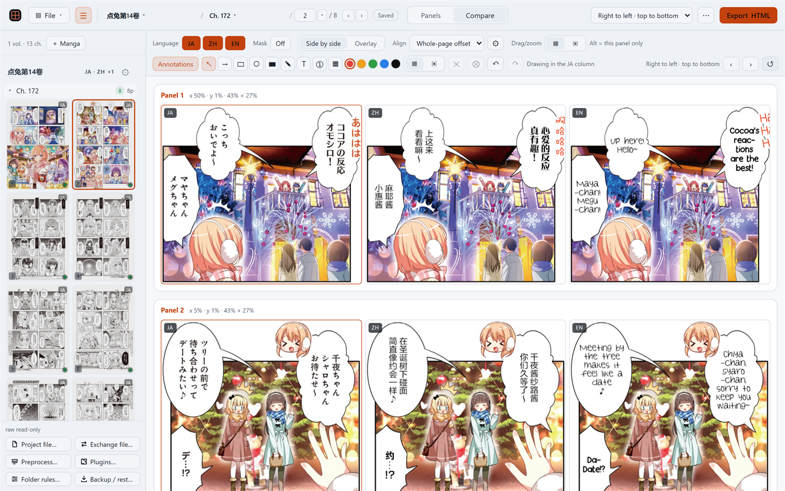

# 对照阅读

对照阅读把两种或三种语言中的同一个分格并排放在一起——或叠放在一起——并让你对齐画面，使对照真正可信。

<figure class="shot">
  
  <figcaption>三语并排模式。每种语言各占一栏；对齐按页面保存，并会应用在导出中。</figcaption>
</figure>

## 它解决什么问题

同一本书的两个版本很少几何完全一致：扫描件会有偏移、裁切或缩放差异。整页对看会掩盖细微差别。**逐格对照**，并让每种语言独立对齐，才能看清措辞、语气和省略。

## 布局

| 控件 | 行为 |
| --- | --- |
| **JA / ZH / EN** 标签 | 开启或关闭某种语言。本页缺失的语言会被禁用并显示提示。 |
| 拖动标签 | 调整各栏顺序。顺序会被记住。 |
| `↺` | 恢复默认语言顺序（JA、ZH、EN）。 |
| **并排** | 每种选中语言一列。窄窗口中各栏纵向堆叠。 |
| **叠加** | 所有选中语言画在同一个框内。 |
| **正片叠底**（仅叠加） | 图层相乘，让线稿透出来。 |
| **对齐对象** 标签（仅叠加） | 选择你正在拖动的语言，避免两栏同时移动。 |

## 遮蔽

遮蔽会盖住某种语言的画面，方便你检验自己的理解。

| 控件 | 行为 |
| --- | --- |
| **遮蔽：开 / 关** | 总开关。`H` 切换；`Shift+H` 全部显示。 |
| 各语言的 `◐` / `◯` 标签 | 选择遮蔽哪些语言。 |
| **遮蔽样式** | **模糊** 或 **色块**。 |
| **全遮** | 重新遮蔽当前所有可见栏。 |
| **全显** | 关闭总开关。 |
| **默认…** | 记住哪些语言默认遮蔽，跨会话生效。 |
| 点击已遮蔽的栏 | 临时显示；再次点击画面可重新遮蔽。 |

遮蔽只是**阅读偏好**。HTML 和 PNG 导出永远不会包含遮蔽。遮蔽默认值保存在浏览器中，不在页面 JSON 里。

## 缩放、平移与作用域

- 在某一栏上**滚轮**会缩放该语言。只有指针位于栏内时才会捕获滚轮，因此其他区域的正常翻页不受影响。
- **拖动**某一栏可平移。
- **拖动/缩放**作用域有两种模式：**整页** 和 **当前格**。
- 按住 `Alt` 拖动或滚轮，只调整当前格，无论默认作用域是什么。
- **上一格 / 下一格** 在不离开当前视图的情况下切换焦点分格。
- **全部复位** 清除当前作用域内的偏移。

每种语言有 `{ x, y, scale }`。`x` 和 `y` 是分格宽高的比例；`scale` 在 0.5× 到 3× 之间缩放裁切区域。

## 对齐模式

对齐保存在页面 JSON 中，永远不会烘焙进图片。

| 模式 | 行为 | 适用 |
| --- | --- | --- |
| **整页偏移** | 拖动任意分格都会平移该语言的整页。 | 整份扫描件存在相同偏移。 |
| **逐格偏移** | 每个分格有自己的偏移。 | 电子版与纸质版的分格位置不同。 |
| **锚点对齐** | 先在参考语言上点一个特征点，再在另一种语言上点同一点；偏移自动算出。 | 精确、可重复地对齐某个细节。 |
| **网格吸附** | 拖动时吸附到 0.5%、1%、2% 或 5% 的步长。 | 需要整齐、可复现的数值偏移。 |

锚点模式会显示一条提示，说明参考语言。先在任意一格点一个特征点，再在另一格点同一位置。**取消取点** 清除待定锚点。待定的锚点不会保存。

### 对齐设置

**对齐设置** 会打开一个面板，包含：

- **目标**语言标签。
- 所选目标的确切 **X**、**Y** 和 **缩放** 输入框。
- **重置本页所有格** —— 清除逐格偏移；整页偏移不受影响。
- **重置当前格** —— 只清除所选分格的逐格偏移。
- **存为页预设** / **存为话预设** —— 把当前对齐保存到 `data/presets/align.json`。
- 选择预设，然后 **套用本页** 或 **套用整话**；**删除** 移除预设。

预设记录对齐模式、偏移、逐格偏移和网格步长。整话共享同一偏移时，套用话预设是修复整话的最快方式。

## 实用的对照流程

1. 在 **对照阅读**（`C`）中打开页面。
2. 启用 `JA` + `ZH`（如有 `EN` 也启用），按你想要的阅读顺序排列。
3. 如果各版本的分格差异不同，选 **逐格偏移**；否则先用 **整页偏移**。
4. 拖动每种语言的栏，直到分格内容对齐。
5. 如果本话其余页面共享同一偏移，保存一个对齐预设。
6. 切到 **叠加** 并开启正片叠底，找出线稿或文字的差异。
7. 打开遮蔽自测，然后逐栏显示。

## 行为细节

- 导出时也会应用对齐偏移，因此导出的裁切结果与你看到的画面一致。
- 阅读器需要先有分格。页面没有分格时，会提示前往切格工作台。
- 切换页面会保留遮蔽偏好，但清除临时显示。
- 每一栏带有笔记数；在这里选中分格后，新建笔记会限定到共享笔记栏中的该分格。
- 缺失的语言显示占位，而不是空白栏。

<figure class="shot">
  

    <strong>截图待补：对照工具栏特写</strong>
    语言标签、遮蔽控件、对齐模式和作用域切换的裁剪截图将补在这里。
  

  <figcaption>计划中的截图：带编号标注的对照工具栏。</figcaption>
</figure>

## 常见坑

- **“这一页还没有分格。”** 到 **分格**（`P`）运行 **自动切格**，然后返回。
- **我拖动时其他语言也跟着动。** 叠加模式下检查 **对齐对象** 标签；只有选中的语言会被拖动。
- **缩放漂移了。** 逐格缩放和逐格偏移与整页值分开存储。如果测试用的缩放没复位，重置当前格。
- **滚动时画面乱跳。** 只有指针在栏内时才捕获滚轮；把指针移到页面边缘即可正常滚动。
- **截图里出现了遮蔽。** 遮蔽是界面偏好，不属于导出内容，但普通屏幕截图会带上它。
- **某个标签是灰的。** 该语言在本页没有图片。检查图库警告或卷的语言映射。

## 缺失的截图

| 图 | 用于 |
| --- | --- |
| 对照工具栏特写 | 语言顺序、遮蔽、对齐模式、作用域 |
| 默认遮蔽浮层 | 各语言的默认遮蔽 |
| 锚点模式步骤 1 / 步骤 2 | 参考点与算出的偏移 |
| 对齐设置面板 | 数值输入与预设 |

## 相关

- [切格工作台](/zh/guide/panels) —— 必须先有分格。
- [笔记](/zh/guide/notes) —— 把观察记下来。
- [远端存储与备份](/zh/guide/remote) —— 图片未缓存在本地时的行为。
