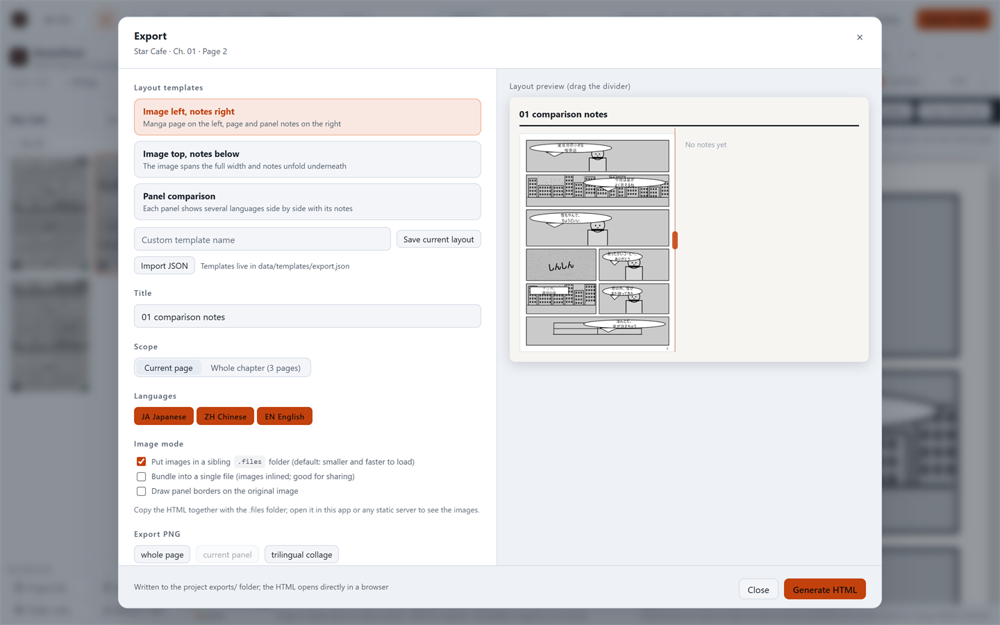

# 导出

导出把一章的分格与笔记变成可阅读、可打印或可分享的内容：HTML 学习文档、用于幻灯片的 PNG，或带到另一台机器的工程包。

<figure class="shot">
  
  <figcaption>导出对话框。左栏用于配置文档；右侧预览版式，拖动分隔线可以调整大小。</figcaption>
</figure>

## 它解决什么问题

你的笔记在应用里，挂在分格上。要在平板上复习、打印，或把对照结果放进幻灯片，就需要一个可携带的产物，让页面图片和对应笔记保持在一起——而且不必上传任何东西。

## 打开对话框

按 `E`，或点击顶栏的 **导出**。对话框总是导出你当前查看的页面或话。

## HTML 导出

### 标题与范围

| 控件 | 作用 |
| --- | --- |
| **标题** | 文档标题，也用于建议的文件名。 |
| **当前页** | 只导出打开的页面。 |
| **整话（n 页）** | 导出本话中所有已标注的页面。 |
| **只导出有笔记的页** | 跳过没有笔记的页；适合整理学习笔记合集。 |
| **语言** | 文档中出现的语言。 |

### 图片方式

| 模式 | 行为 |
| --- | --- |
| **同名 `.files` 目录**（默认） | HTML 引用同级文件夹中的图片。体积更小、加载更快。两者需一起复制。 |
| **打包成单文件** | 图片以 data URL 内嵌。只分享一个文件，但整话可能达到几十兆字节。 |

**在原图上标出格子边框** 会把分格矩形叠加到导出的画面上。它与标注无关。

**只导出含这些标签的批注** 按标签筛选笔记；**清除筛选** 取消选择。

### 版式

三个内置版式模板：

| 模板 | 结果 |
| --- | --- |
| **左图右注** | 漫画页在左，整页与格级笔记在右。 |
| **上图下注** | 图片占满宽度，笔记在下方展开。 |
| **分格对照** | 每个分格并排展示多种语言，并附该格笔记。 |

版式模板可以用自定义名称保存，导出为 JSON 再导入。它们保存在 `data/templates/export.json`。版式控件包括：

| 控件 | 效果 |
| --- | --- |
| **图栏宽度** | 图片栏宽度，按百分比。 |
| **栏目间距** | 图片与笔记之间的间距。 |
| **字号** | 文档的基础字体缩放。 |
| **每行列数** | 每行放置多少个页面块。 |

版式会自动记住。你也可以拖动实时预览中的分隔线来设置图片宽度。

### 生成

1. 选择范围、语言、图片方式和版式。
2. 点击 **生成 HTML**。
3. 完成后，对话框会报告导出了多少页、文件写到了哪里。
4. 用 **打开 HTML** 在浏览器中打开，或用 **下载 HTML** 另存一份。使用默认图片方式时，请一并复制 `.files` 目录。

文件写入项目的 `exports/` 目录。HTML 可以直接从磁盘打开。

### 打印

生成的 HTML 包含打印样式：背景被移除，页宽不受限制，页面块不会从图片中间分页。在浏览器中打开文件，用常规 **打印** 命令，通过浏览器打印对话框生成 PDF。

::: tip 打印为 PDF
目前获取 PDF 的受支持方式是浏览器的“另存为 PDF”。原生 PDF 导出器尚未实现——见[工程文件与格式](/zh/guide/project-files)。
:::

## PNG 导出

**导出 PNG** 区域直接生成图片，不产出文档：

| 模式 | 内容 |
| --- | --- |
| **整页** | 整页图片，含分格边框与标注。 |
| **单格** | 选中的分格，裁剪并对齐。 |
| **三语拼图** | 把所选语言并排放置同一个分格（未选中分格时为整页）。 |

选项：

- **包含标注（n）** —— 把标注图层画进 PNG。数字表示将包含多少条标注。
- 整页与单格 PNG 使用**首选（基准）语言**；拼图使用所选的对照语言。
- 未在工作台选中分格时，**单格** 不可用。

PNG 在浏览器中生成，落在浏览器的下载目录。可以直接粘贴到幻灯片、文档或聊天窗口。

## 导出模板

导出模板（`.mnexp`）保存版式与样式设置，便于复用或分享同一种外观。通过侧栏的 **交换文件…** 导出和导入模板。导入的模板会先校验，原文件备份到 `data/backups/exchange/`。

## 常见坑

- **HTML 里的图片打不开。** 使用默认模式时，`.files` 目录必须与 HTML 一起移动。请把两者放在一起。
- **单文件导出体积巨大。** 这是预期结果：每张图片都被内嵌。整话请用 `.files` 模式。
- **导出里少了一页。** 它没有笔记且开启了 **只导出有笔记的页**，或者在所选语言下没有图片。
- **PNG 里没有分格边框。** PNG 导出使用标注开关；启用 **包含标注**，并记住分格边框来自分格矩形，而不是标注。
- **打印输出被裁切。** 把浏览器打印缩放设为“适应页面”，只在需要底色时启用背景图形。
- **输出文件夹不可写。** 在打包的桌面版中，`exports/` 位于所选的图库文件夹内。

<figure class="shot">
  

    <strong>截图待补：导出的 HTML 与 PNG 结果</strong>
    浏览器中生成的 HTML 以及三种 PNG 模式的并排截图将补在这里。
  

  <figcaption>计划中的截图：导出的文档与 PNG 输出。</figcaption>
</figure>

## 缺失的截图

| 图 | 用于 |
| --- | --- |
| 导出的 HTML 页面 | 两栏与上下堆叠版式 |
| PNG 模式对比 | 整页 / 单格 / 拼图 |
| 导出模板控件 | 保存、导入与套用 |

## 相关

- [笔记](/zh/guide/notes) —— 最终进入文档的内容。
- [工程文件与格式](/zh/guide/project-files) —— 改为导出整个工程。
- [键盘快捷键](/zh/guide/shortcuts) —— `E` 打开这个对话框。
