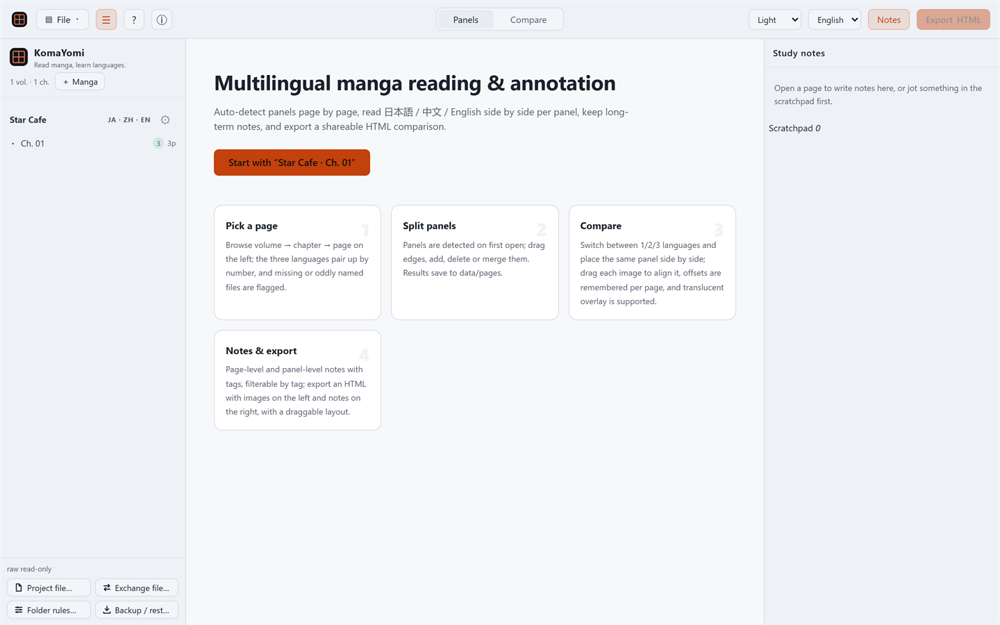

# 图库与导入

图库在每次应用加载时扫描 `raw/` 文件夹构建而成。没有数据库，也没有复制图片的导入步骤：**目录结构本身就是配置**。

本页介绍如何组织文件、扫描器如何配对语言、如何添加位于其他位置的文件夹，以及有哪些导入入口。

## 它解决什么问题

漫画扫描片的文件夹结构千奇百怪：`Vol.14/Japanese/ch01`、`点兔第14卷/ja/172`、`manga/zh-cn/172`。你希望有一个书架统一列出卷和话，把每种语言的第 1 页与其他语言的第 1 页配对，并在缺文件时告诉你缺在哪里——而不用重命名或移动任何东西。

## 目录结构

```text
raw/
  <volume>/
    <language-dir>/
      <chapter>/
        001.jpg
        002.jpg
```

- **卷** 是 `raw/` 下的任意一级文件夹。
- **话** 是语言目录内的任意文件夹。各语言的话会取并集，因此某种语言可能缺少某一话的文件夹。
- **页面按排序位置配对，而不是按文件名。** 每种语言的文件先做自然排序（连续数字按数值比较），再按索引配对。`1.jpg`、`2.jpg`、`10.jpg` 能正确排序。

<figure class="shot">
  
  <figcaption>侧栏按 卷 → 话 → 页 列出。语言标记显示该卷存在哪些语言；警告会就地显示。</figcaption>
</figure>

## 语言目录名

扫描器会先规范化文件夹名（转小写，空格和下划线转为连字符），再与别名匹配：

| 语言 | 可识别的目录名 |
| --- | --- |
| 日语（`ja`） | `ja`、`jp`、`jpn`、`japanese`、`ja-jp`、`日`、`日本語`、`日文` |
| 中文（`zh`） | `zh`、`zh-cn`、`zh-hans`、`zh-sg`、`cn`、`chs`、`zh-tw`、`zh-hk`、`zh-hant`、`cht`、`tw`、`hk`、`中`、`中文`、`繁中`、`简中` |
| 英语（`en`） | `en`、`en-us`、`en-gb`、`us`、`uk`、`eng`、`english`、`英`、`英文` |

如果文件夹名无法识别，该卷仍会出现在图库中，但会带一条警告。打开 **卷设置**（卷所在行的齿轮）把目录指定为某种语言。选择保存在 `data/library.json`：

```json
{
  "volumes": {
    "点兔第14卷": {
      "dirs": { "ja": "raw-ja", "zh": "raw-zh" }
    }
  }
}
```

一卷可以有一种、两种或三种语言。对照阅读只提供当前页实际存在的语言。

## 添加位于其他位置的文件夹

**＋ 添加漫画** 有两种模式：

| 模式 | 结果 |
| --- | --- |
| 路径留空 | 在 `raw/` 下创建一个空文件夹。 |
| 选择已有文件夹 | 在 `raw/` 下创建一个指向原目录的**目录链接**。图片不会被复制；链接的行为与普通文件夹一致，因此标注仍可正常写入。 |

可选：为这一卷指定一个不同的显示名称。输入框下方的提示会重申预期的目录结构：`language/chapter/page.jpg`。

**从图库移除**（位于卷设置）只删除 `raw/` 下的链接；原文件夹中的图片不受影响，已经保存到 `data/pages/` 的标注也会保留。

在普通浏览器中无法弹出文件夹选择框。请直接填写绝对路径，或使用桌面版并点击 **选择文件夹…**。

## 页面与语言的角色

有三种容易混淆的“角色”：

| 角色 | 在哪里选择 | 影响什么 |
| --- | --- | --- |
| **底图** | 切格工作台工具栏 | 在哪种语言的画面上画分格。分格矩形由该页的所有语言共用。 |
| **对照语言** | 对照阅读的语言标签 | 显示哪些语言、以什么顺序显示。不必启用所有语言。 |
| **首选语言** | PNG 导出 | 整页与单格 PNG 使用基准语言；三语拼图使用所选的对照语言。 |

分格与笔记按页面存储一份，而不是每种语言一份。对齐偏移按语言存储，也可以按分格存储。

## 你会看到的警告

图库警告只是提示信息，页面仍然可以打开。

| 警告 | 含义 | 处理 |
| --- | --- | --- |
| *未识别到语言目录* | 没有任何子文件夹匹配别名。 | 在卷设置里手工映射，或重命名。 |
| *未识别的目录：…* | 语言目录旁边还有其他文件夹。 | 映射它们，或直接忽略。 |
| *各语言页数不一致* | 各语言的文件数量不同。 | 配对按索引进行；补齐或删除缺失的那一页。 |
| *本话扩展名混用* | 例如 `.jpg` 与 `.png` 交替出现。 | 通常无妨；如果在意缩略图一致，可统一格式。 |
| *文件名与页序不符* | 文件名开头的数字与它的排序位置不一致。 | 如果这种不一致意味着缺页或多页，请重命名。 |

## 目录识别规则

**目录识别…**（侧栏）让你用占位符描述页文件路径，而不必依赖固定的 `volume/language/chapter` 结构：

- 占位符：`series`、`volume`、`chapter`、`language`、`page`。
- `*` 匹配任意一段；`**` 匹配一个可选段。
- 规则按顺序尝试，第一个命中生效。
- 对话框带实时预览：命中了多少文件和卷、哪些文件未识别、每一话包含哪些页。
- **填入默认规则** 恢复内置结构；**恢复默认** 放弃你的修改。
- **保存规则** 用新规则重新扫描图库。

规则只影响识别，绝不会重命名或移动文件。

## 导入、交换与恢复

侧栏里有四个不同的入口，各自负责不同的事：

| 入口 | 用途 |
| --- | --- |
| **添加漫画** | 把已有图片文件夹链接进图库。 |
| **工程文件…** | 导出或导入 `.mnproj` 包（图片 + 标注 + 模板 + 语言设置）。 |
| **交换文件…** | 传递 `.mntpl` 版式模板、`.mnexp` 导出模板，或单个 `.mnpage.json` 页面。 |
| **备份 / 恢复** | 把 `data/` 打包成 ZIP，或恢复之前的 ZIP。 |

导入会先校验，原文件会备份到 `data/backups/`。文件内容和版本规则见[工程文件与格式](/zh/guide/project-files)。

::: tip 导入顺序
想把标注恢复到同一台机器上，用**备份**恢复。换到另一台机器时导入**工程**。只想分享一个版式、一种导出样式或一页时，用**交换文件**。
:::

## 导航与性能

| 操作 | 快捷键 |
| --- | --- |
| 上一页 / 下一页 | `[` / `]` |
| 切格工作台 | `P` |
| 对照阅读 | `C` |
| 显示 / 隐藏侧栏 | `S` |
| 显示 / 隐藏笔记栏 | `N` |
| 打开导出对话框 | `E` |
| 帮助 | `?` |

URL hash 可以深链接：`#/<volume>/<chapter>/<page>/<panels|compare>`。

缩略图按需生成，缓存在 `data/cache/thumbs/`。删除该目录是安全的，下次访问时会重新生成。图片格式从文件头判断，因此扩展名为 `.png` 但实际是 JPEG 的文件仍能正确显示。

## 常见坑

- **重命名文件会改变它的页位置。** 配对按排序索引进行；在中间插入一页会把其后所有页后移。把新页加在末尾，或整话统一重命名。
- **缺一种语言不是错误。** 页面仍可打开，对照阅读会为缺失的语言显示占位。
- **目录链接不是副本。** 移动或删除原文件夹后，图库会失效。移动后请重新添加该文件夹。
- **WebP 可以显示，但不会解码用于检测。** 依赖自动切格时请使用 JPEG 或 PNG（见[切格工作台](/zh/guide/panels)）。
- **以侧栏为准。** 如果某一卷或某一话没有出现，先检查文件夹名大小写和语言别名。

## 相关

- [切格工作台](/zh/guide/panels) —— 页面打开之后要做什么。
- [工程文件与格式](/zh/guide/project-files) —— `.mnproj` 里有什么。
- [远端存储与备份](/zh/guide/remote) —— 把图片放在 NAS 或 WebDAV 上。
