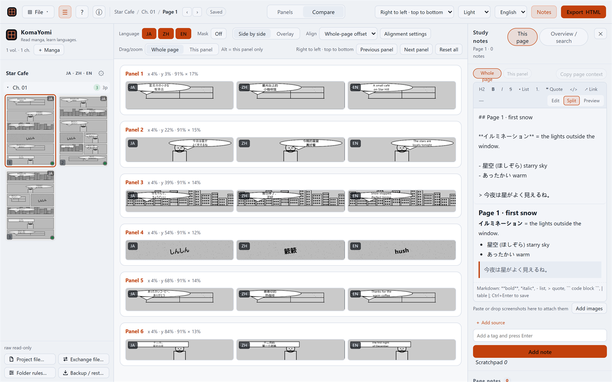

# 笔记

笔记是分格与对齐存在的理由。一条笔记可以属于整页，也可以属于某一格；它用 Markdown 编写，可以带标签、来源和附图。

<figure class="shot">
  
  <figcaption>笔记栏位于舞台右侧，可以收起。编辑器上方的工具栏用于插入 Markdown；标签栏在“本页”和全局总览之间切换。</figcaption>
</figure>

## 它解决什么问题

像“这版翻译丢了敬语”这样的记录，一旦脱离它所指的对话框就失去意义。这里的笔记挂在页面或分格 id 上，因此能经受页面重排、模板变更和导出。第二个问题是检索：翻过五十页之后，你需要找出所有打了 `语气` 标签、或来自某一篇文章的笔记。

## 页面笔记与格级笔记

| 范围 | 何时使用 | 存储为 |
| --- | --- | --- |
| **页面** | 整体观察、校对意见、关于某一页的疑问。 | `scope: "page"`、`panelId: null` |
| **分格** | 措辞、语气、某个对话框、翻译差异。 | `scope: "panel"`、`panelId: "<panel id>"` |

在工作台或对照阅读中选中一个分格，下一条笔记就会限定到该分格。没有选中时，笔记是页面级。编辑器占位文字会说明当前作用域：*记录这一格的原文……* 还是 *记录整页的观察……*。

## 写一条笔记

1. 在 **本页** 标签页中点击编辑器。
2. 输入 Markdown。工具栏会插入常用语法：

| 按钮 | 插入 |
| --- | --- |
| **B** | 加粗（`Ctrl+B`） |
| *I* | 斜体（`Ctrl+I`） |
| • 列表 | 无序列表 |
| ❝ 引用 | 引用块 |
| `</>` | 行内代码 |
| ↗ 链接 | 链接（`Ctrl+K`） |
| H | 标题 |
| S | 删除线 |
| 1. | 有序列表 |
| — | 分割线 |

3. 选择模式：**编辑**、**分栏**（编辑器 + 预览）或 **预览**。
4. 按 `Ctrl+Enter` 或点击 **添加笔记**。

渲染输出会转义原始 HTML；HTML 永远不会被执行。在支持 Markdown 之前写的笔记仍按纯文本加换行渲染。

## 标签

- 输入标签后按 `Enter` 添加。
- 标签以数组形式存储在笔记上。
- 用量会在所有页面中汇总并作为建议提供，**筛选** 行可以按标签筛选当前页。

标签是构建个人分类体系最省力的方式：`语气`、`误译`、`文化`、`待确认`、`拟声词`。

## 附图

笔记可以带截图——适合记录参考页、版本对照，或纸质书的照片。

- 把图片**粘贴**到编辑器，或**拖放**到笔记表单。
- **添加图片** 打开文件选择器；每张附图都有缩略图和移除按钮。
- 小于 400 KB 的图片按原样存储（data URL）。更大的图片会缩放到最长边 1600 px，再以质量 0.85 重新编码为 WebP。
- 图片存放在页面 JSON 中笔记的 `images` 数组里，因此会随页面一起进入导出和工程文件。图片太多会让 JSON 变大；宁可用几张裁剪后的参考图，也不要用整页图。

## 来源

每条笔记都可以带一个来源：

- **URL** —— 粘贴链接。笔记正文中的第一个 URL 会自动填入。**抓标题** 会尝试读取页面标题，超时 5 秒；如果抓取被拦截，请手动输入标题。
- **自由文本** —— 例如 `ChatGPT 对话 2026-05-12`、书名或访谈名称。

来源显示在笔记下方，可用 **收起来源** 切换显示。

## 复制给大模型的上下文

**复制本页上下文** / **复制上下文** 会从当前页、选中的分格、笔记正文、标签和来源拼出一段提示词。

- 复制对话框有一个可编辑的 **模板前缀**。
- 支持的占位符：`{volume}`、`{chapter}`、`{page}`、`{panel}`、`{notes}`、`{text}`、`{tags}`。
- 对模板的修改会自动记住。
- **预览** 显示将要复制的确切内容；**复制** 把它放进剪贴板。

默认模板会要求模型解释语言点、语气和文化背景，并指出理解错误。按你偏好的讲解风格调整一次，之后每次复制都会沿用。

## 总览与搜索

**总览 / 搜索** 标签页在整个图库范围内工作，而不只是当前页：

- 搜索笔记正文、标签和来源。
- 按卷、话、页码、标签或来源筛选。
- 按话、标签或来源聚合结果。
- 结果标题会报告命中多少条笔记、覆盖多少页。
- 点击结果跳转到该页；笔记如果是格级，还会跳到该分格。

**清除筛选** 重置当前查询。

## 暂存区

暂存区用于记录那些还没想好归属的想法。

1. 在 **随手记暂存** 中输入，按 `Ctrl+Enter` 或点击 **记下**。
2. 之后用 **归到本页** 或 **归到本格** 把它变成正式笔记。

## 编辑与删除

每条已保存的笔记都有 **编辑**、**复制上下文**、**按标签筛选** 和删除操作。笔记上的 **渲染 / 源码** 开关在渲染后的 Markdown 和原始文本之间切换。删除分格会删除它的格级笔记，因此想与版式解耦的内容请用页面笔记。

## 常见坑

- **笔记跑到了错误的作用域。** 检查编辑器上方那句话：它要么写出格号，要么写着*整页*。取消选中分格即可写页面笔记。
- **`Ctrl+Enter` 没反应。** 焦点必须在笔记编辑器内；在搜索框中不会触发该快捷键。
- **粘贴的截图太大。** 超过限制的图片会自动缩小，但整页截图仍然很重；先裁剪。
- **标签筛选隐藏了笔记。** **筛选** 行是按页生效的，与总览的筛选不是一回事。
- **文字看起来像代码。** 围栏代码块需要三个反引号各自独占一行。

<figure class="shot">
  

    <strong>截图待补：带工具栏与附图的笔记编辑器</strong>
    Markdown 工具栏、标签行和图片缩略图的特写将补在这里。
  

  <figcaption>计划中的截图：编辑器工具栏、标签与附件。</figcaption>
</figure>

## 缺失的截图

| 图 | 用于 |
| --- | --- |
| 笔记编辑器特写 | Markdown 工具栏、标签、附件 |
| 总览搜索 | 筛选、聚合与跳转到页面 |
| 复制上下文对话框 | 模板前缀与预览 |

## 相关

- [对照阅读](/zh/guide/compare) —— 大多数笔记在这里产生。
- [导出](/zh/guide/export) —— 笔记如何变成学习文档。
- [键盘快捷键](/zh/guide/shortcuts) —— 编辑器与全局按键。
